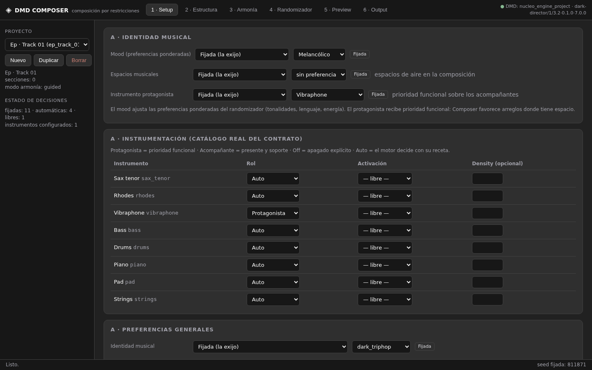
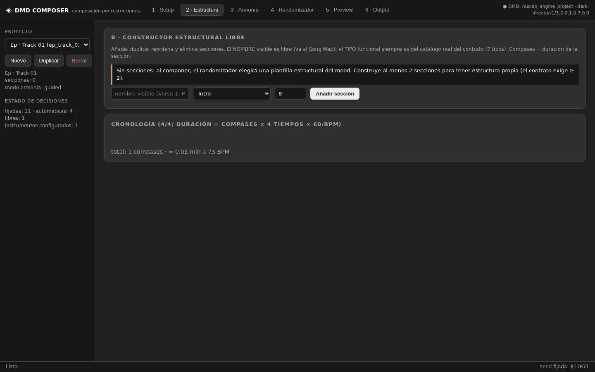
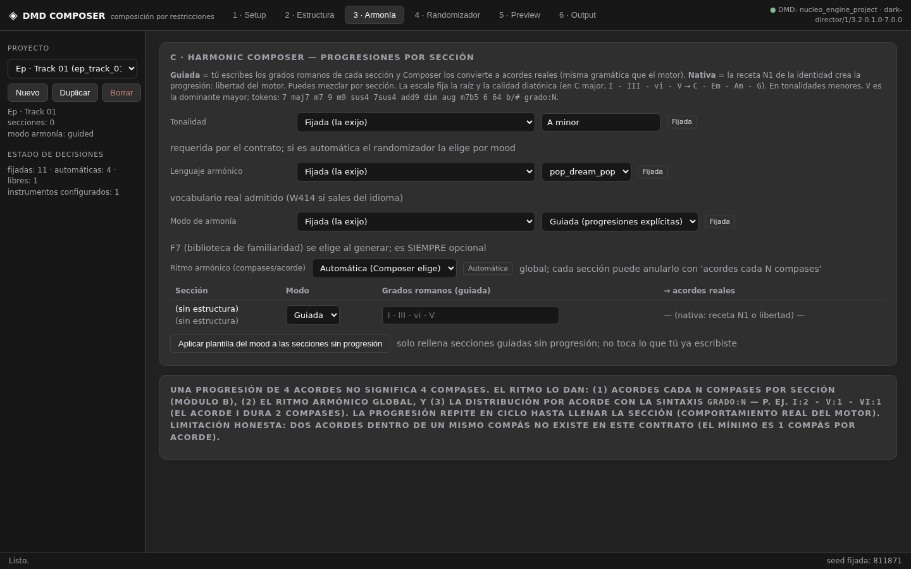
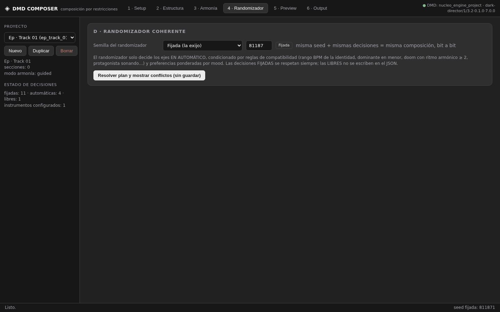
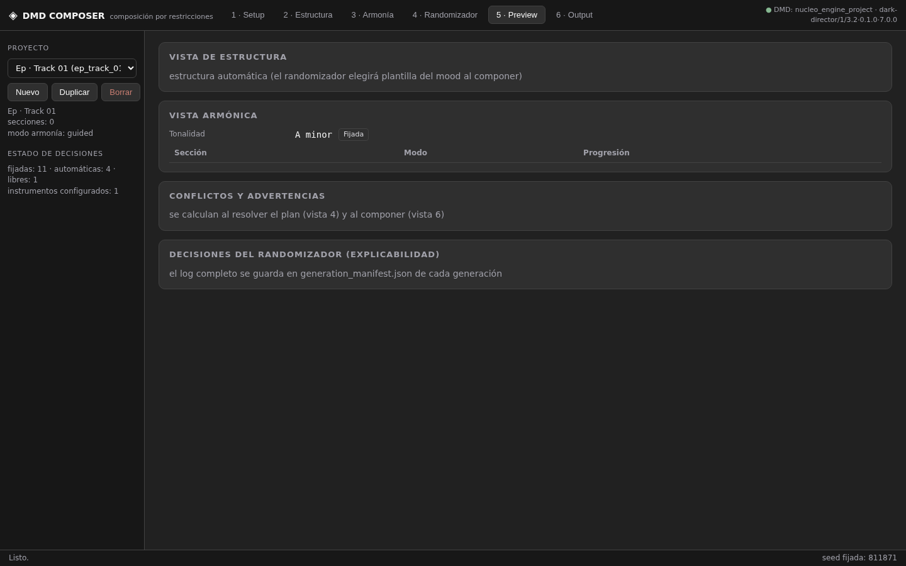
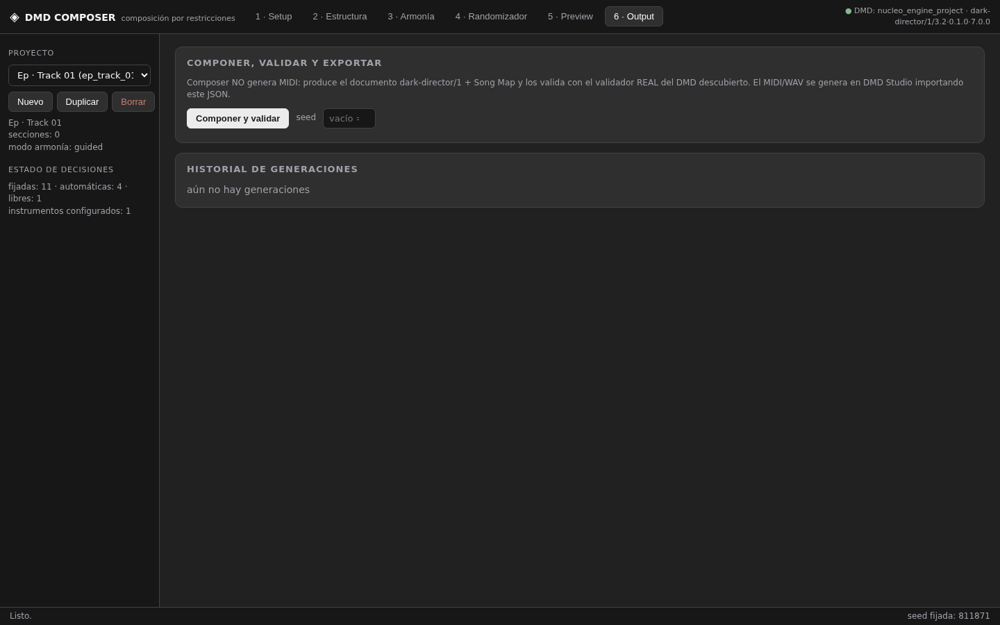

# MANUAL TÉCNICO Y OPERATIVO DE DMD COMPOSER 1.1

> **Nota de planificación v1.2 (2026-11-11):** este manual documenta el código
> REAL instalado (v1.1) y sigue siendo exacto para ese comportamiento. La
> misión de planificación v1.2 redefinió el ámbito del producto (Composer
> generará MIDI por el pipeline existente vía puente aislado, reproducirá con
> el Player WebAudio de Forge + `events.json`, y gestionará álbumes completos
> con producción por lotes; la conversión de audio queda EXCLUIDA — decisión
> D22). Esas capacidades están PLANIFICADAS, no implementadas: ver
> `IMPLEMENTATION_ROADMAP.md` y `DECISIONS.md` (D21–D28). Las secciones que
> dicen "Composer no genera MIDI ni WAV" describen la v1.1 y se actualizarán
> durante la implementación de cada fase.

| | |
|---|---|
| **Aplicación** | DMD COMPOSER 1.1.0 (formato de proyecto `dmd-composer/1`) |
| **Fecha del manual** | 2026-11-11 (v1.0 auditoría) · 2026-11-11 (v1.1 resolución) |
| **Base de este manual** | Código REAL de la versión instalada (paquete `composer/`, 15 módulos Python + UI vanilla JS), contrato real `dark-director/1 rev 3.2`, validador y compilador reales del DMD descubierto, baterías de pruebas A–H + I ejecutadas (114/114 OK) y las 5 demostraciones reproducibles de `profiles/` |
| **DMD de referencia** | `dark-director/1 rev 3.2 · compilador 0.1.0 (fase1) · jazz_engine 7.0.0 · target midi-forge/1` |
| **v1.0 (auditoría)** | Documentación y auditoría informativa exclusivamente: no se modificó ningún archivo funcional. Las discrepancias halladas quedaron registradas en el Anexo A (D-01…D-10) |
| **v1.1 (resolución)** | Misión de resolución: se investigaron las causas raíz de las discrepancias y limitaciones y se corrigieron en código. **Las 10 discrepancias del Anexo A quedaron resueltas** (ver estado por D-x en el propio Anexo A y `docs/CHANGELOG_1.1.md`). Motores protegidos, contrato y Studio intactos (hashes verificados) |

**Cómo leer este manual.** Cada afirmación está contrastada con el código fuente (se cita el archivo y el comportamiento exacto) o con una ejecución real verificada. Este manual nació como auditoría informativa v1.0 (sin corregir nada: las diferencias se registraron en el **Anexo A — Registro de auditoría y discrepancias**); la misión de resolución v1.1 investigó las causas raíz y corrigió las 10 discrepancias y las limitaciones abordables — cada D-x indica su estado de resolución en el propio Anexo A y el detalle técnico completo está en `docs/CHANGELOG_1.1.md`.

**Capturas de pantalla.** Las capturas reales de las 6 pantallas están en `docs/img/` (`01_setup.png` … `06_output.png`, v1.0; `11_output_v11.png` y `12_album_v11.png`, v1.1), tomadas sobre la aplicación en ejecución con el DMD real descubierto.

**Novedades v1.1 (resolución de la auditoría).** Las 10 discrepancias del Anexo A quedaron resueltas y se añadieron capacidades nuevas, todas verificadas con la batería I (114 tests en verde):

1. **Propuesta de distribución del protagonista** (Vista 1, panel propio): aceptar / modificar / rechazar; campos reales del contrato; §5.3.
2. **Editor de acordes literales por sección** (`G/B - Dm9:2 - Fmaj7`) con prevalidación por el parser REAL del DMD: Vista 3, columna propia; §6.2 y §9.4 (`fuente: explicito`).
3. **Semántica definitiva Native/Guided** sin conversiones silenciosas (avisos `armonia-implicita` y `guiada-ignorada`): §6.2.
4. **Instrucción de producción verificable** en Vista 6 y en el manifest (`produccion.instruccion`, estado "seleccionado_pendiente_de_aplicar"): §9.4.
5. **Manifest de un solo estado por eje** (`decisiones` disjuntos + `preferencias_composer`): §7.2bis y §9.4.
6. **Botón Verificar DMD** (re-introspección inmediata y detección de cambios de fingerprint): barra superior.
7. **Identidades archivadas** marcadas en el selector y avisadas al componer: §3/§5.
8. **Modo álbum**: "Generar TODAS las pendientes" (reanudable) + **informe de diversidad** con distancias tonales: §10.
9. **Groove ≠ tempo** documentado en el propio log; BPM fijado se conserva exacto: §7.2bis.
10. **Descartadas registradas** en todas las elecciones ponderadas: §8.

---

## ÍNDICE

1. [Introducción y arquitectura](#1-introducción-y-arquitectura)
2. [Cómo iniciar y utilizar la aplicación](#2-cómo-iniciar-y-utilizar-la-aplicación)
3. [Explicación de todas las pantallas](#3-explicación-de-todas-las-pantallas)
4. [Catálogo completo de opciones y valores](#4-catálogo-completo-de-opciones-y-valores)
5. [Diferencia entre Composer y DMD](#5-diferencia-entre-composer-y-dmd)
6. [Native vs Guided Harmony](#6-native-vs-guided-harmony)
7. [Fixed vs Auto vs Free](#7-fixed-vs-auto-vs-free)
8. [Randomizador y diversidad](#8-randomizador-y-diversidad)
9. [Song Map y archivos de salida](#9-song-map-y-archivos-de-salida)
10. [Modo álbum](#10-modo-álbum)
11. [Recetas prácticas](#11-recetas-prácticas)
12. [Errores habituales y solución](#12-errores-habituales-y-solución)
13. [Limitaciones conocidas](#13-limitaciones-conocidas)
14. [Glosario musical y técnico](#14-glosario-musical-y-técnico)
- [Anexo A — Registro de auditoría y discrepancias](#anexo-a--registro-de-auditoría-y-discrepancias)

---

## 1. Introducción y arquitectura

### 1.1 Qué es DMD Composer

DMD Composer es una **aplicación local de composición por restricciones**. No genera MIDI ni WAV: produce un **documento JSON `dark-director/1` (rev 3.2)** que se importa en **DMD Studio**, donde el pipeline existente (validador → compilador → MIDI Forge → FluidSynth) genera el MIDI y el audio.

Su función es decidir, **antes** de que el motor componga, tres tipos de cosas:

1. **Quién es la canción** (Módulo A — Musical Identity Designer): identidad musical, accesibilidad, instrumentos con roles, groove, espacios, atmósfera, mood y producción.
2. **Cómo está construida** (Módulo B — Structural Composer): secciones, orden, duración, energía/tensión/densidad, batería por sección, focos y whitelist de instrumentos.
3. **Qué acordes suenan** (Módulo C — Harmonic Composer): tonalidad, lenguaje armónico y progresiones por sección en grados romanos, convertidas a los símbolos de acordes reales que el motor entiende.

Además incluye:

- **Módulo D — Coherent Randomizer**: decide los ejes que el usuario no fijó, con reglas de compatibilidad y preferencias ponderadas (nunca dados independientes).
- **Módulo E — Song Map**: representación estructural legible (JSON + CSV + grid por compás + bloque para letras) que acompaña al documento.
- **Modo álbum**: planificador de N pistas con identidad compartida y diversidad controlada.

### 1.2 Los tres estados de decisión (la regla de oro)

Cada decisión tiene **tres estados** que NO se pueden confundir:

| Estado | Significado exacto | Qué ocurre en el JSON |
|---|---|---|
| **Fijada (fixed)** | El usuario exige ese valor. El sistema lo respeta tal cual, nunca lo "mejora" ni lo sustituye en silencio | Se escribe EXACTO en `doc.json` |
| **Automática (auto)** | Composer toma una decisión concreta y coherente (condicionada por reglas de compatibilidad y preferencias ponderadas) | El valor elegido **se escribe** en `doc.json` y queda registrado en el log de explicabilidad |
| **Libre (free)** | El usuario delega en el motor DMD: Composer deliberadamente **no escribe el campo** | El campo **no aparece** en `doc.json`; la receta N1 y los motores del DMD deciden con su comportamiento interno |

`Automática ≠ Libre`: automática es una decisión concreta de Composer escrita en el JSON; libre es la ausencia deliberada del campo. Esta distinción es la columna vertebral del producto (ver §7).

### 1.3 Arquitectura (verificada contra el código)

```
DMD_Composer/
├── composer/                 paquete Python (14 módulos)
│   ├── model.py              decisiones fixed/auto/free, Section, HarmonySection, proyecto
│   ├── harmony.py            parser REAL de grados romanos → símbolos de acordes
│   ├── structure.py          validación estructural, cronología, reordenar/duplicar
│   ├── randomizer.py         módulo D: hard constraints + compatibility + preferencias
│   ├── builder.py            construcción del doc dark-director/1 + pre-chequeos de conflictos
│   ├── songmap.py            módulo E: Song Map JSON/CSV + grid por compás
│   ├── engine.py             orquestación completa de una generación
│   ├── albums.py             modo álbum: plan, diversidad, huellas, reanudación
│   ├── bridge.py             puente subprocess al DMD real (sin shell, timeouts)
│   ├── dmd_bridge_runner.py  proceso hijo aislado que usa los módulos REALES del DMD
│   ├── manifest.py           manifiesto de capacidades: vivo → caché → instantánea
│   ├── store.py              persistencia atómica, SHA256, generaciones sin sobrescribir
│   ├── server.py             FastAPI local (127.0.0.1:8898), límites de tamaño, sin eval
│   ├── __main__.py           arranque: python -m composer → http://127.0.0.1:8898
│   └── static/               UI vanilla JS (app.js, state.js, views.js, api.js, composer.css)
├── projects/<pid>/project.json       proyectos del usuario (dmd-composer/1)
├── output/<pid>/gen_NNNN/            generaciones (doc, song_map.json/csv, generation_manifest)
├── output/albumes/<album_id>/plan.json  planes de álbum (dmd-album/1)
├── composer_data/            config local (composer_config.json) + manifiesto cacheado
├── manifests/dmd_manifest_builtin.json  instantánea derivada del DMD real (fallback offline)
├── profiles/                 5 demostraciones reproducibles (con SHA256)
├── tests/                    batería A–H (77 tests)
├── scripts/                  install.bat · check.bat · start.bat · demostraciones.py
└── docs/                     este manual + ARCHITECTURE, COMPATIBILITY, LIMITATIONS, TEST_REPORT, USER_MANUAL
```

**Flujo real de una generación** (`composer/engine.py::compose`, verificado línea a línea):

```
proyecto (decisiones + secciones + armonía por sección)
  1. normalize_sections      → valida la estructura del usuario (E106/E105 anticipados)
  2. randomizer.resolve(seed)→ plan resuelto + log de explicabilidad
     resolve_auto_structure  → si el usuario no construyó secciones, plantilla del mood
  3. builder.conflicts       → errores / avisos / sugerencias
     (si hay ERRORES duros: NO se genera nada)
  4. builder.build           → documento dark-director/1 (solo campos reales del validador)
     songmap.build_song_map  → Song Map + CSV (misma precedencia §2.8 y ciclo del motor)
  5. bridge.validate_doc     → validador REAL del DMD descubierto (subprocess aislado)
     bridge.compile_preview  → compilador REAL sin renderizar (control extra)
  6. store.save_generation   → output/<pid>/gen_NNNN/ (nunca sobrescribe; SHA256)
```

### 1.4 Integración con el DMD real

- **Descubrimiento** (`composer/bridge.py::discover_dmd`): ruta configurada en `composer_data/composer_config.json` → carpetas hermanas del paquete → directorio de trabajo. Se exige encontrar `dark_director/contract.py`. No hay rutas absolutas fijas.
- **Aislamiento total**: Composer **nunca** importa DMD en su propio proceso. Todo va por subprocess con `dmd_bridge_runner.py --spec … --out …` (argv fijo, sin shell), timeouts de 60 s (introspección/validación) y 120 s (compilación) y spec JSON ≤ 8 MB.
- **Fuente de verdad de los catálogos**: los instrumentos, tipos de sección, escalera de drums, identidades, accesibilidades, lenguajes, resoluciones, recetas N1 completas, perfiles de producción y keywords F7 se leen **EN VIVO del DMD real** y se cachean en `composer_data/dmd_manifest.json` con fingerprint (`dark-director/1/3.2·0.1.0·7.0.0`). El fallback offline es la instantánea derivada `manifests/dmd_manifest_builtin.json`, verificable con el test A8.
- **El árbitro final siempre es el validador real** del DMD descubierto. Los pre-chequeos de Composer solo anticipan lo que el validador diría; si el validador real rechaza, la generación se aborta y se muestra el código del contrato.

### 1.5 Qué NO es Composer

- **No es un generador nota por nota**: nunca escribe `development.*` (frases, motifs, improvisación). Eso es libertad del motor (regla 10 de la misión).
- **No genera MIDI ni WAV**: no duplica el pipeline.
- **No modifica DMD, Studio ni los motores protegidos**: solo los descubre y los usa. El test F6 verifica con hashes que los 10 archivos protegidos quedan intactos.
- **No introduce campos que el validador no admita**: el test A2 verifica cero E109 (campos desconocidos) en documentos complejos.

---

## 2. Cómo iniciar y utilizar la aplicación

### 2.1 Instalación (Windows 10, Python 3.12)

| Paso | Comando | Qué hace (verificado leyendo `scripts/*.bat`) |
|---|---|---|
| 1 | `scripts\install.bat` | Comprueba Python en PATH, crea `.venv` e instala **solo** `fastapi==0.115.6` + `uvicorn==0.34.0` (las mismas dependencias web de Studio; cero dependencias nuevas) |
| 2 | `scripts\check.bat` | Descubre el DMD real, ejecuta la introspección EN VIVO (refresh forzado) y muestra: origen del manifiesto, fingerprint, 8 instrumentos, 7 tipos de sección, identidades con receta N1, 7 perfiles. Termina en `CHECK OK` |
| 3 | `scripts\start.bat` | Arranca en `http://127.0.0.1:8898` (solo localhost). Studio usa el 8899: **pueden estar abiertos a la vez** |

Si `check.bat` no encuentra el DMD, crea `composer_data\composer_config.json` con la ruta de tu instalación:

```json
{"dmd_path": "C:\\Users\\Homeless\\Documents\\Midi\\nucleo_engine_project"}
```

y vuelve a ejecutar `check.bat`. La API exige que la ruta configurada contenga `dark_director/contract.py` (si no, devuelve 400 con ese mensaje exacto).

### 2.2 Primer contacto con la interfaz



- **Barra superior**: navegación `1 · Setup / 2 · Estructura / 3 · Armonía / 4 · Randomizador / 5 · Preview / 6 · Output` y, a la derecha, el **indicador de integración**: `● DMD: <carpeta> · <fingerprint>` en verde cuando hay DMD real, o `DMD no descubierto — configura la ruta (catalogo de instantánea)` cuando no.
- **Barra lateral izquierda**:
  - Selector de **proyecto** + botones `Nuevo` / `Duplicar` / `Borrar` (Borrar pide confirmación; elimina proyecto **y sus generaciones**).
  - Meta del proyecto: nombre, número de secciones, modo de armonía.
  - **Estado de decisiones**: `fijadas: N · automáticas: N · libres: N` + `instrumentos configurados: N` (se recalcula en vivo al cambiar cualquier decisión).
- **Barra inferior de estado**: mensajes de la aplicación (`Listo.`, errores en rojo, confirmaciones en verde) y, a la derecha, `seed fijada: N` o `seed automática`.
- Al abrir la app sin proyectos, se crea automáticamente un proyecto de bienvenida *"Mi primera composición"* para que la UI arranque siempre con un proyecto activo.
- La primera ejecución no necesita nada más: los catálogos que pueblan todos los selectores vienen de `/api/system` (catálogos REALES del DMD). **Nada está inventado en el cliente** (regla implementada en `views.js`).

### 2.3 Flujo de trabajo recomendado

1. **Vista 1 · Setup**: fija identidad, mood, protagonista e instrumentación. Deja el resto en Automático.
2. **Vista 2 · Estructura**: dibuja las secciones (o deja la estructura automática del mood).
3. **Vista 3 · Armonía**: fija tonalidad y escribe progresiones por sección (o usa plantilla del mood, o Nativa).
4. **Vista 4 · Randomizador**: pulsa **"Resolver plan y mostrar conflictos (sin guardar)"** — ensayo general que muestra errores, avisos y el plan completo con su explicación.
5. **Vista 5 · Preview**: revisa estructura y armonía junto al log de decisiones.
6. **Vista 6 · Output**: **"Componer y validar"** (opcionalmente con seed), descarga `doc.json` e impórtalo en DMD Studio (§9.5).

### 2.4 Proyectos y persistencia

- Un proyecto es un archivo `projects/<pid>/project.json` en formato `dmd-composer/1` (máx. 512 KB). Todo cambio de la UI se guarda automáticamente (PUT `/api/projects/{pid}`) tras cada edición.
- `Duplicar` copia decisiones, instrumentos, secciones, armonía por sección, producción y diversidad a un proyecto nuevo.
- Las generaciones se guardan en `output/<pid>/gen_NNNN/` con **creación exclusiva del directorio**: dos composiciones concurrentes no colisionan y **nunca se sobrescribe** una generación existente.
- Escritura siempre **atómica** (archivo `.tmp` + `os.replace`): un corte de luz no deja JSON a medias.

### 2.5 Cómo importar el resultado en DMD Studio

1. Descarga `doc.json` desde la Vista 6 (botón `⬇ doc.json`).
2. Abre Studio (`http://127.0.0.1:8899`) → **PROJECTS** → crea un proyecto nuevo.
3. **ADVANCED JSON EDITOR**: pega el contenido de `doc.json` y guarda. El botón **Validar** de Studio usa el mismo validador real y debe decir `✓ válido para dark-director/1`.
4. **GENERATION** → perfil de producción (el que decidiste en Composer, ver §3.1) → seed (si la dejas vacía, Studio usa `global.seed` del documento, que Composer siempre escribe: verificado en `studio/runner.py`, que registra `seed=global.seed` cuando no se pasa seed explícita) → **Generar MIDI**.
5. **Harmony** (opcional): aquí se elige F7 (biblioteca de familiaridad) y su nivel de variación. Es SIEMPRE voluntaria y nunca viaja en el documento (test A6).

---

## 3. Explicación de todas las pantallas

Cada pantalla se documenta con: para qué sirve, cada control con sus valores, el comportamiento verificado en código y los mensajes que produce.

### 3.0 Módulos ↔ pantallas

| Módulo de la misión | Pantalla donde se controla |
|---|---|
| A · Musical Identity Designer | Vista 1 · Setup |
| B · Structural Composer | Vista 2 · Estructura (+ cronología) |
| C · Harmonic Composer | Vista 3 · Armonía |
| D · Coherent Randomizer | Vista 4 · Randomizador (+ selector de diversidad en Vista 1) |
| E · Preview | Vista 5 · Preview |
| F · Output | Vista 6 · Output |

---

### 3.1 Vista 1 · Setup — Módulo A: Musical Identity Designer

**Para qué sirve:** decidir QUIÉN es la canción. Contiene cuatro paneles.

#### 3.1.1 Panel "A · Identidad musical"

| Control | Valores | Comportamiento verificado |
|---|---|---|
| **Mood (preferencias ponderadas)** | Melancólico / Oscuro / Esperanzador / Tenso / Neutro (valores internos `melancholic/dark/hopeful/tense/neutral`) | NO fuerza nada: pondera las pools del randomizador (tonalidad, lenguaje, accesibilidad, atmósfera, groove, ending), elige la plantilla estructural automática y las plantillas de progresión. Por defecto Fijada en `neutral`. No aparece en `doc.json` (es un parámetro del plan). El texto de ayuda de la UI lo dice literalmente |
| **Espacios musicales** | `sin preferencia` / `sugeridos` / `obligatorios` (valores internos `free/suggested/mandatory`) | Tampoco entra en el doc. Con estructura **automática**: `suggested` o `mandatory` garantizan una sección de aire (inserta un `break` con `active=[vibraphone, rhodes, pad]` y `drums=light` si la plantilla no traía ninguno; regla "compatibilidad espacios" en el log). Con estructura propia: solo genera avisos "conflicto-suave" si no hay ninguna sección de aire o si lo combinas con atmósfera `dense` |
| **Instrumento protagonista** | `— sin protagonista —` + los 8 instrumentos reales del catálogo | Prioridad funcional: §5.3 detalla EXACTAMENTE qué hace (garantía de sonido + conflictos duros); la prioridad artística se materializa con `focus` por sección en la Vista 2 |

Texto de ayuda real del panel: *"El mood ajusta las preferencias ponderadas del randomizador (tonalidades, lenguaje, energía). El protagonista recibe prioridad funcional: Composer favorece arreglos donde tiene espacio."*

#### 3.1.2 Panel "A · Instrumentación (catálogo real del contrato)"

Tabla con los **8 instrumentos reales** (`sax_tenor, rhodes, vibraphone, bass, drums, piano, pad, strings`) — la lista viene del manifiesto del DMD, no de una lista propia de Composer. Tres columnas por instrumento:

| Columna | Opciones | Efecto exacto |
|---|---|---|
| **Rol** | `Auto` / `Protagonista` / `Acompañante` / `Off` | `Off` → escribe `enabled=false` en el doc (apagado explícito). `Auto`/`Acompañante`/`Protagonista` **no escriben nada por sí solos**: el rol es una decisión de Composer que se expresa en el doc solo vía `enabled` (activación) y `focus` (secciones). Puede haber UN solo protagonista: marcar dos es conflicto duro |
| **Activación** | `— libre —` / `enabled=true` / `enabled=false` | `— libre —` (default) no escribe nada: el motor usa el set base de la identidad. `enabled=true` fuerza un instrumento fuera del set base (p. ej. Piano en dark_triphop). El validador real puede emitir **E114** si no puede inicializarse con seguridad; Composer anticipa ese riesgo con el aviso `E114-riesgo` |
| **Density (opcional)** | número 0–1, paso 0.05, vacío = libre | Se escribe en `instruments.<id>.density`. **Ojo**: en esta versión bass/drums/pad/strings no la usan → aviso `W410` (density sin traducción). Déjala vacía salvo que sepas lo que haces |

El set base de cada identidad (del manifiesto real, campo `set_base`):

| Identidad | set_base (instrumentos que suenan por defecto) | lead |
|---|---|---|
| `dark_triphop` | sax_tenor, rhodes, vibraphone, bass, drums, pad | sax_tenor |
| `doom_triphop` | sax_tenor, rhodes, vibraphone, bass, drums, pad, strings | sax_tenor |
| `doom_dark_jazz` | sax_tenor, rhodes, vibraphone, bass, drums, piano, strings | sax_tenor |

Todo instrumento fuera del set base necesita `enabled=true` para sonar (o aparecer en el doc con enabled). Regla espejo `suena()` (idéntica a la del validador): `set_base ∪ enabled=true − enabled=false − exclusiones de active`.

#### 3.1.3 Panel "A · Preferencias generales"

Once filas de decisión (cada una con selector de estado Fijada/Automática/Libre y, si es Fijada, el control de valor):

| Eje | Valores fijables | Default en proyecto nuevo | Límite "Libre" |
|---|---|---|---|
| **Identidad musical** (`identity`) | `dark_triphop`, `doom_triphop`, `doom_dark_jazz` | Fijada `dark_triphop` | **No disponible**: el contrato exige el campo (E103). La opción Libre aparece deshabilitada con el texto "Libre — no disponible: el contrato exige este campo" |
| **Accesibilidad** (`accessibility`) | `commercial`, `balanced`, `experimental` | Automática | No disponible (E103) |
| **BPM** (`bpm`) | entero 20–300 | Automática | Disponible. Rango típico por identidad: dark_triphop 70–96, doom_triphop 58–90, doom_dark_jazz 50–74. Un BPM fijado fuera del rango se RESPETA y se avisa W401 |
| **Tonalidad** (`key`) | texto: `D minor`, `C major`, `A dorian`, `Eb minor`, `F# harmonic minor`… | Automática | No disponible (E103). Parseo ESTRICTO (§6.3): `Do menor` es rechazado como error porque el motor lo leería como D minor |
| **Lenguaje armónico** (`language`) | `pop_dream_pop`, `hybrid`, `experimental` | Automática | No disponible (E103) |
| **Resolución** (`resolution`) | `tonal`, `modal`, `deceptive`, `chromatic`, `open` | **Libre** (default del lenguaje) | Disponible: Libre = el campo no se escribe |
| **Ritmo armónico** (`harmonic_rhythm_bars`) | entero 1–8 (compases por acorde) | Automática | Disponible. En identidades doom el automático nunca elige 1 (regla de compatibilidad); fijar 1 en doom dispara W402 |
| **Atmósfera** (`atmosphere`) | `spacious`, `medium`, `dense` | Automática | Disponible. Sesgo de densidad del randomizador; condiciona el perfil de producción automático. No entra en el doc |
| **Groove** (`groove`) | `laid_back`, `steady`, `driving` | Automática | Disponible. Sesgo de drums y BPM (curva del BPM automático). No entra en el doc |
| **Cierre (ending)** (`ending`) | `fade_out`, `tape_stop`, `none` | Automática | Disponible. SÍ entra en el doc (bloque `ending`); `none` → no se escribe nada |
| **Perfil de producción** (`production`) | `— elegir al generar —` + `original, sax, sax_rhodes, drums, sax_vibes, full, atmospheric` | Automática | Disponible. **Se usa al generar el MIDI en Studio; NO entra en el JSON del contrato.** Es una nota para ti (el texto de ayuda lo dice literalmente) |

#### 3.1.4 Panel "D · Randomizador: nivel de diversidad"

| Control | Valores | Efecto |
|---|---|---|
| **Diversidad** | Contenida (`restrained`) / Equilibrada (`balanced`) / Aventurada (`adventurous`) | Aplana las preferencias ponderadas: factor de aplanado 0.0 / 0.45 / 0.8. Contenida = gustos marcados del mood; Aventurada = explora más opciones no obvias (siempre coherentes). Default: Equilibrada |
| **Nombre de la obra** | texto | Va a `meta.title` del doc |
| **Notas** | texto (máx. 300 caracteres) | Va a `meta.notes` del doc |

---

### 3.2 Vista 2 · Estructura — Módulo B: Structural Composer



**Para qué sirve:** dibujar el esqueleto de la canción sección a sección, sin plantilla obligatoria. Texto real del panel: *"Añade, duplica, reordena y elimina secciones. El NOMBRE visible es libre (va al Song Map); el TIPO funcional siempre es del catálogo real del contrato (7 tipos). Compases = duración de la sección."*

Si no hay secciones, la UI muestra el aviso: *"Sin secciones: al componer, el randomizador elegirá una plantilla estructural del mood. Construye al menos 2 secciones para tener estructura propia (el contrato exige ≥ 2)."*

#### 3.2.1 Añadir secciones

Fila "Añadir sección" con: **nombre visible** (texto libre, placeholder "nombre visible (Verse 1, Preludio…)"), **tipo funcional** (los 7 del contrato), **compases** (número, default 8) y botón `Añadir sección`. El `id` de sección se genera automáticamente como slug único del nombre (`verse 1` → `verse_1`; si existe → `verse_1_2`, …).

#### 3.2.2 Los 7 tipos funcionales reales (tal como los muestra la UI)

| Valor interno (va al doc) | Etiqueta en la UI | Uso típico |
|---|---|---|
| `intro` | Intro | apertura |
| `verse` | Verse | verso / refrain |
| `pre_chorus` | Pre-Chorus | escalada previa al estribillo |
| `chorus` | Chorus | estribillo (admite `loop_bars` = hook) |
| `bridge` | Bridge | puente |
| `break` | Break / Interlude / Solo | instrumental, breakdown, solo |
| `outro` | Outro / Coda | cierre |

**Nombres visibles ≠ tipos.** El contrato solo entiende los 7 tipos; el nombre bonito ("Estribillo grande", "Preludio", "Verse 2") viaja **solo** al Song Map (nunca al doc, para no disparar E109). Dos secciones pueden compartir tipo con ids distintos y progresiones distintas (`harmony.progressions` se indexa por **id**).

#### 3.2.3 Controles por sección (tarjeta de sección)

| Control | Rango / valores | Efecto en el doc |
|---|---|---|
| Nombre visible (`label`) | texto libre (máx. 40) | Solo Song Map |
| Tipo funcional (`type`) | 7 del catálogo | `structure[].type` |
| Compases (`bars`) | entero 1–512 | `structure[].bars` |
| `↑` / `↓` | reordenar | cambia el orden en `structure[]` |
| `Duplicar` | copia completa con id único (`…_copy`, `…_copy2`…) | nueva sección idéntica |
| `✕` | eliminar | — |
| **energy** | 0–1, paso 0.05, vacío = libre | `structure[].energy` |
| **tension** | 0–1, paso 0.05, vacío = libre | `structure[].tension` (≥ 0.67 sin pad/strings sonando → W409) |
| **density** | 0–1, paso 0.05, vacío = libre | `structure[].density` |
| **drums** | `— libre —` / `off` / `air` / `light` / `groove` / `heavy` (escalera real de 5) | `structure[].drums` |
| **acordes cada (compases)** (`chord_bars`) | entero 1–8, vacío = hereda global | `structure[].chord_bars` (si no divide los compases de la sección → W417) |
| **final** | checkbox | `structure[].final=true` (si lo marcas en varias → W415, gana la última en orden) |
| **focus (máx 3)** | checkbox por instrumento (la UI impide marcar un 4.º) | `structure[].focus` |
| **active (whitelist)** | checkbox por instrumento; vacío = todos | `structure[].active` — SOLO suenan los marcados (herramienta de los espacios: un break con solo Vibraphone + Rhodes + Pad y drums en light) |

#### 3.2.4 Cronología

Panel "Cronología (4/4; duración = compases × 4 tiempos × 60/BPM)": barra proporcional coloreada por tipo de sección + resumen `total: N compases · ≈ X min a Y BPM` si el BPM está Fijado, o `BPM automático (la duración exacta se calcula al componer)` si no. La métrica es 4/4 fija del contrato (limitación documentada, §13).

#### 3.2.5 Validaciones del módulo B (mensajes exactos)

Se ejecutan al componer (y en el preview de estructura vía API). Errores que bloquean:

- `la estructura necesita al menos 2 secciones (E106 del contrato)` / `la estructura tiene 1 sección(es): el contrato exige ≥ 2 (E106)`
- `id de sección duplicado '<id>' (E106): renombra una de las dos`
- `sección '<id>': tipo '<tipo>' fuera del catálogo real [...]`
- `sección '<id>': compases debe ser entero 1–512 (got X)`
- `sección '<id>': energy|tension|density fuera de 0–1 (X)`
- `sección '<id>': drums 'X' fuera de la escalera off/air/light/groove/heavy`
- `sección '<id>': focus admite máximo 3 instrumentos`
- `sección '<id>': chord_bars debe ser 1–8` / `loop_bars debe ser 1–32`

---

### 3.3 Vista 3 · Armonía — Módulo C: Harmonic Composer



**Para qué sirve:** escribir los acordes de cada sección con grados romanos y ver la conversión a acordes reales EN VIVO. El texto real del panel explica: *"Guiada = tú escribes los grados romanos de cada sección y Composer los convierte a acordes reales (misma gramática que el motor). Nativa = la receta N1 de la identidad crea la progresión: libertad del motor. Puedes mezclar por sección. La escala fija la raíz y la calidad diatónica (en C major, `I - III - vi - V` → `C - Em - Am - G`). En tonalidades menores, `V` es la dominante mayor; tokens: `7 maj7 m7 9 m9 sus4 7sus4 add9 dim aug m7b5 6 64 b/# grado:N`."*

#### 3.3.1 Controles globales del panel

| Control | Valores | Notas |
|---|---|---|
| **Tonalidad** (`key`) | texto libre (`D minor`…) | Requerida por el contrato. Si es Automática, el randomizador la elige por mood. La vista previa en vivo exige tonalidad Fijada (si no: "fija la tonalidad para ver la conversión") |
| **Lenguaje armónico** (`language`) | 3 del catálogo | vocabulario real admitido (W414 si sales del idioma) |
| **Modo de armonía** (`harmony_mode`) | `Guiada (progresiones explícitas)` / `Nativa (recetas N1)` | Ayuda real: "F7 (biblioteca de familiaridad) se elige al generar; es SIEMPRE opcional". Ver §6 para la semántica EXACTA de mezclar |
| **Ritmo armónico** (`harmonic_rhythm_bars`) | 1–8 | global; cada sección puede anularlo con "acordes cada N compases" |

#### 3.3.2 Tabla por sección

Una fila por sección (o la fila `(sin estructura)` si aún no hay secciones): **Sección** (nombre visible + id) · **Modo** (Guiada/Nativa) · **Grados romanos (guiada)** (input, placeholder `I - III - vi - V`) · **→ acordes reales** (conversión en vivo con chips; el tooltip de cada chip muestra `roman · calidad <tier>` y `· no diatónico` cuando aplica). Los avisos W414 (fuera del vocabulario del lenguaje) se muestran bajo los chips al instante.

Botón **"Aplicar plantilla del mood a las secciones sin progresión"**: rellena SOLO las secciones en modo Guiada sin numeración, con una plantilla coherente con el mood (determinista: la misma pareja mood+tonalidad produce SIEMPRE la misma plantilla — el seed interno es `sha256(mood|key)`). Texto real del botón complementario: *"solo rellena secciones guiadas sin progresión; no toca lo que tú ya escribiste"*. Requiere tonalidad Fijada (si no: "fija la tonalidad para usar plantillas").

#### 3.3.3 Gramática de grados romanos admitida (verificada contra `harmony.py` y los tests C)

| Elemento | Sintaxis | Ejemplo (C major) | Regla exacta |
|---|---|---|---|
| Grados | `I II III IV V VI VII` (mayúsc./minúsc. decorativa) | `I - III - vi - V` → `C - Em - Am - G` | La calidad por defecto es la TRÍADA DIATÓNICA de la escala del modo: en C major III es Em porque E-G-B es la tríada del 3.er grado. No es conversión superficial por índice |
| Alteraciones | `b` / `#` antes del grado | `bVI` → `Ab`, `bVII` → `Bb`, `#iv0` → `Gbdim` | Un grado alterado es mayor por defecto (préstamos del modo paralelo: bVI, bVII, bII). Un token explícito siempre gana |
| Calidades | `maj M m min 7 maj7 m7 mmaj7 9 maj9 m9 11 maj11 m11 13 maj13 m13 sus4 sus2 sus 7sus4 add9 add11 add13 add6 dim o ° dim7 aug + m7b5 ø m6 5 7b9 7#11 7#5b9 7b5 7#5` | `Imaj7`, `ii m7`, `V7` | El token SUSTITUYE a la calidad diatónica |
| Dominante en menor | `V` / `V7` en tonalidad menor | en A minor: `V`→`A`, `V7`→`E7` | Convención estándar del pop (dominante mayor). Para el v menor escribe `Vm` |
| Inversiones | cifra `6` (1.ª) y `64` (2.ª), o bajo explícito `/3` `/5` | `vi6` → `Am/C`, `ii64` → `Dm/A` | `I6` es primera inversión, NO "I con sexta añadida" (eso es `Iadd6`). Cifrado + bajo a la vez no se admite; calidad + cifra tampoco (`V7/B` es la forma correcta) |
| Bajo literal | `/` + nota | `V7/B` | — |
| Duración por acorde | `Grado:N` (ENTERO 1–64) | `I:2 - V:1` | Se emite con la sintaxis real `Chord:bars` del motor. Fraccionarios rechazados con error ("los fraccionarios no existen en este contrato") |
| Separadores | `-` `–` `—` `\|` `,` y espacios | `i, iv, VII` | — |
| Ciclo | automático | 4 acordes en 16 compases con rhythm 1:1 → 4 ciclos | La progresión repite en ciclo hasta llenar la sección (comportamiento REAL de `forge/engine.py`) |

**Modos de tonalidad admitidos** (8): major/ioniano, minor/eólico, dorian, phrygian, lydian, mixolydian, locrian, `harmonic minor` (menor armónica). Ortografía resultante: con bemoles (Db, Eb, Gb, Ab, Bb), idéntica a la del compilador y a `FLAT_NAMES` de Forge.

#### 3.3.4 Panel "Ritmo armónico avanzado (opcional)"

Texto real: *"Una progresión de 4 acordes NO significa 4 compases. El ritmo lo dan: (1) acordes cada N compases por sección (módulo B), (2) el ritmo armónico global, y (3) la distribución POR ACORDE con la sintaxis `grado:N` — p. ej. `I:2 - V:1 - vi:1` (el acorde I dura 2 compases). La progresión repite en ciclo hasta llenar la sección (comportamiento real del motor). Limitación honesta: dos acordes DENTRO de un mismo compás no existe en este contrato (el mínimo es 1 compás por acorde)."*

#### 3.3.5 Errores del módulo C (mensajes exactos)

- `tonalidad no reconocida: '<texto>' (usa 'C major', 'D minor', 'A dorian'...)`
- `modo no reconocido en '<texto>'. Usa: major/minor, dorian, phrygian, lydian, mixolydian, locrian o 'harmonic minor'.`
- `progresión vacía`
- `grado no reconocido en la posición N: '<token>'. Formato: [b|#]I..VII [calidad] [6|64] [:compases] [/bajo].` (con pista `¿quisiste 'iio' (con la letra o) para el acorde disminuido?` si el token contiene "0")
- `compases por acorde inválidos en la posición N: '<token>' — usa un ENTERO de 1 a 64 ('I:2'); los fraccionarios no existen en este contrato`
- `cifrado y bajo a la vez no se admiten: '<token>'`
- `calidad + cifra de inversión juntas no se admiten ('<token>'); usa el bajo explícito, p. ej. 'V7/B'`
- Al componer, una sección guiada sin progresión: `[progresion] sección <id>: sección guiada sin progresión → escribe grados romanos p. ej. 'I - III - vi - V' o cámbiala a nativa`

---

### 3.4 Vista 4 · Randomizador — Módulo D: Coherent Randomizer



**Para qué sirve:** ver y controlar QUÉ decide Composer. Controles: la **seed** (fila de decisión con hint "misma seed + mismas decisiones = misma composición, bit a bit") y el botón **"Resolver plan y mostrar conflictos (sin guardar)"** (ensayo general: no escribe nada en disco).

El resultado del ensayo muestra:

1. **Errores** en rojo con formato `[<código>] <dónde>: <mensaje> → <cómo arreglarlo>` (bloquean la generación).
2. **Avisos** en ámbar `[<código>] <dónde>: <mensaje>` (W4xx: nunca bloquean).
3. **Sugerencias** informativas (p. ej. drums off).
4. **Semilla usada** (`Semilla usada: N`).
5. **Tabla "Decisiones del plan"** con columnas **Eje / Estado / Valor / Por qué** — una fila por eje: tus decisiones fijadas ("decisión del usuario"), las automáticas (con la regla que decidió) y las libres ("el motor DMD decide (no se escribe el campo)").
6. Línea final: `Libres (no se escriben; el motor decide): <lista>` o `ninguno`.

La semántica completa del randomizador (reglas, pools reales, diversidad, seeds, explicabilidad e incompatibilidades) está en **§8**.

---

### 3.5 Vista 5 · Preview — Módulo E



**Para qué sirve:** revisión final antes de producir. Cuatro paneles:

| Panel | Qué muestra | Definitivo o provisional |
|---|---|---|
| **Vista de estructura** | Tabla `# / Sección / Tipo / Compases / Params fijados` (lista energy, tension, density, drums, focus, active, chord_bars, loop_bars, final; si no hay nada: "todo libre"). Sin secciones → "estructura automática (el randomizador elegirá plantilla del mood al componer)" | Los valores de sección son los tuyos (definitivos); la estructura automática aún no existe (provisional hasta componer) |
| **Vista armónica** | Tonalidad (con su estado Fijada/Automática) + tabla `Sección / Modo / Progresión` (los numerales escritos o `— receta N1 —`) | Definitivo respecto a TU decisión; los acordes reales que escribirá el motor en modo nativo se ven al componer (Song Map) |
| **Conflictos y advertencias** | Nota real: "se calculan al resolver el plan (vista 4) y al componer (vista 6)" | Provisional hasta resolver/componer |
| **Decisiones del randomizador (explicabilidad)** | Tabla `Eje / Estado / Valor / Razón / Descartadas` con el último plan resuelto; nota real: "el log completo se guarda en generation_manifest.json de cada generación" | Definitivo para el último plan resuelto |

**Cómo detectar errores antes de generar:** resuelve el plan en la Vista 4 (mismos chequeos que la composición final, incluido el validador real) y lee errores/avisos aquí; cada error incluye el fix sugerido.

---

### 3.6 Vista 6 · Output — Módulo F



**Para qué sirve:** producir el documento y llevarlo a Studio. Texto real: *"Composer NO genera MIDI: produce el documento dark-director/1 + Song Map y los valida con el validador REAL del DMD descubierto. El MIDI/WAV se genera en DMD Studio importando este JSON."*

| Control | Comportamiento |
|---|---|
| **seed** (input, "vacío = automática") | Seed de la composición (entero ≥ 0). Vacío → Composer genera una seed en 0–999.999 y la guarda. Esta seed es la que viaja a `global.seed` del doc y la que Studio usará por defecto al generar MIDI |
| **"Componer y validar"** | Ejecuta el flujo completo (§1.3). Resultado OK: banner verde `Documento válido para dark-director/1 · seed N · compilado por el compilador real (X compases, midi-forge/1)` + fila `Generación gen_NNNN · SHA256 doc: <hash>` + los 4 botones de descarga. Resultado rechazado: errores/avisos en pantalla y estado HTTP 422 |
| **Descargas** | `⬇ doc.json` · `⬇ song_map.json` · `⬇ song_map.csv` · `⬇ generation_manifest.json` (§9) |
| **Song Map** (tabla) | `# / Sección / Tipo / Compases / Barra inicio-fin / Progresión / Fuente` |
| **"Para escribir la letra"** | Bloque pre-formateado `[Nombre]  (compás inicio–fin, N compases · acordes)` listo para pegar sobre tu letra |
| **doc.json** (pre) | El documento completo tal cual se importa en Studio |
| **Historial de generaciones** | Lista `gen_id · título · seed N · badge "válido"/"sin validación"` + `⬇ doc.json` por fila. Cada clic en Componer crea una generación NUEVA (nunca sobrescribe) |
| **Modo álbum** | §10 completo |

---

## 4. Catálogo completo de opciones y valores

Todos los valores de este catálogo provienen del **manifiesto de capacidades del DMD real** (introspección viva cacheada en `composer_data/dmd_manifest.json`, fingerprint `dark-director/1/3.2·0.1.0·7.0.0`) o de constantes verificadas del código. Nada es una lista paralela inventada.

### 4.1 Catálogos del contrato (8 + 7 + 5 + 3×4)

| Catálogo | Valores completos |
|---|---|
| **Instrumentos (8)** | `sax_tenor` (Sax tenor) · `rhodes` (Rhodes) · `vibraphone` (Vibraphone) · `bass` (Bass) · `drums` (Drums) · `piano` (Piano) · `pad` (Pad) · `strings` (Strings) |
| **Tipos de sección (7)** | `intro` · `verse` · `pre_chorus` · `chorus` · `bridge` · `break` · `outro` |
| **Escalera de drums (5)** | `off` → `air` → `light` → `groove` → `heavy` |
| **Identidades (3)** | `dark_triphop` (activa del ecosistema) · `doom_triphop` (archivada) · `doom_dark_jazz` (archivada) |
| **Accesibilidades (3)** | `commercial` · `balanced` · `experimental` |
| **Lenguajes (3)** | `pop_dream_pop` · `hybrid` · `experimental` |
| **Resoluciones (5)** | `tonal` · `modal` · `deceptive` · `chromatic` · `open` |
| **Perfiles de producción (7)** | `original` · `sax` · `sax_rhodes` · `drums` · `sax_vibes` · `full` (default de Studio) · `atmospheric` |

### 4.2 Los 16 ejes de decisión de Composer

| Eje | Tipo de valor | Rango/valores | Default nuevo proyecto | ¿Llega a doc.json? | Dónde se controla |
|---|---|---|---|---|---|
| `identity` | enum 3 | catálogo 4.1 | Fijada `dark_triphop` | **Sí** → `direction.identity` | Setup |
| `accessibility` | enum 3 | catálogo 4.1 | Automática | **Sí** → `direction.accessibility` | Setup |
| `bpm` | entero | 20–300 | Automática | **Sí** → `global.bpm` | Setup |
| `key` | texto estricto | 12 tónicas × 8 modos | Automática | **Sí** → `harmony.key` (etiqueta normalizada) | Setup + Armonía |
| `language` | enum 3 | catálogo 4.1 | Automática | **Sí** → `harmony.language` | Setup + Armonía |
| `resolution` | enum 5 | catálogo 4.1 | **Libre** | Solo si Fijada o Automática → `harmony.resolution` | Setup |
| `harmonic_rhythm_bars` | entero | 1–8 | Automática | **Sí** → `harmony.harmonic_rhythm_bars` | Setup + Armonía |
| `harmony_mode` | enum 2 | `native` / `guided` | Fijada `guided` | Condiciona si se escribe `harmony.progressions` | Armonía |
| `mood` | enum 5 | §3.1.1 | Fijada `neutral` | **No** (parámetro del plan) | Setup |
| `atmosphere` | enum 3 | `spacious/medium/dense` | Automática | **No** (condiciona producción y avisos) | Setup |
| `groove` | enum 3 | `laid_back/steady/driving` | Automática | **No** (solo curva de BPM automático) | Setup |
| `spaces` | enum 3 | `free/suggested/mandatory` | **Libre** | **No** (estructura automática y avisos) | Setup |
| `protagonist` | id instrumento o `none` | catálogo 8 | **Libre** | Solo efecto indirecto: `enabled=true` si está fuera del set base (§5.3) | Setup |
| `production` | enum 7 o vacío | catálogo 4.1 | Automática | **No** (nota para Studio) | Setup |
| `ending` | enum 3 | `fade_out/tape_stop/none` | Automática | **Sí** → bloque `ending` (excepto `none`) | Setup |
| `seed` | entero | 0–10⁹ (fijada); automática 0–999.999 | Automática | **Sí** → `global.seed` (siempre) | Randomizador |

### 4.3 Parámetros por sección (módulo B)

| Parámetro | Rango | Vacío significa |
|---|---|---|
| `bars` | entero 1–512 | obligatorio (no admite vacío) |
| `energy`, `tension`, `density` | 0.0–1.0 | libre: la receta de la identidad aporta sus valores base (`energy_base`, `tension_base`, `d_receta`) |
| `drums` | escalera de 5 | libre: `drums_nivel` de la receta por tipo de sección |
| `focus` | ≤ 3 ids del catálogo | sin foco declarado |
| `active` | lista blanca de ids | todos los que suenan |
| `chord_bars` | 1–8 | hereda el ritmo armónico global (o el de la receta) |
| `resolution` | enum 5 | sin gesto declarado (última sección con resolution → W412) |
| `loop_bars` | 1–32 (solo chorus, hook) | sin hook (commercial sin hook → W404) |
| `final` | booleano | no es la sección final |

Valores por defecto que aporta la receta de `dark_triphop` cuando dejas la sección libre (del manifiesto real):

| Tipo | energy | tension | drums | focus |
|---|---|---|---|---|
| intro | 0.25 | 0.20 | air | rhodes, pad |
| verse | 0.45 | 0.35 | groove | sax_tenor, drums |
| pre_chorus | 0.60 | 0.55 | light | pad, vibraphone |
| chorus | 0.80 | 0.50 | heavy | sax_tenor, drums, bass |
| bridge | 0.55 | 0.60 | light | rhodes, vibraphone |
| break | 0.35 | 0.60 | light | vibraphone |
| outro | 0.20 | 0.15 | air | rhodes |

### 4.4 Vocabulario de acordes por lenguaje (tiers reales del validador)

| Lenguaje | Calidades de sufijo admitidas (W414 si sales) |
|---|---|
| `pop_dream_pop` (tier "pop") | tríada mayor («»), `6`, `m`, `add9`, `sus2`, `sus4`, `sus`, `7sus4`, `maj7`, `maj9`, `m7`, `m9` |
| `hybrid` (tier "pop"+"hybrid") | todo lo anterior + `7`, `9`, `11`, `13`, `maj11`, `maj13`, `m11`, `m13`, `add11`, `add13`, `5`, `7#11`, `m7b5` |
| `experimental` | todo lo anterior + lo experimental (`7b9`, `7#5`, `dim7`, `aug`…) — el validador las respeta siempre |

### 4.5 Keywords F7 y niveles de variación (opcionales, se eligen en Studio)

- **Keywords (10)**: `familiar_pop`, `melancholic`, `nostalgic`, `dark_cinematic`, `dream_pop`, `alternative`, `soulful`, `emotional_resolution`, `tension_release`, `familiarity_auto`.
- **Niveles de variación (4)**: `none`, `subtle`, `medium`, `rich`.
- La biblioteca F7 introspeccionada contiene 43 recetas (BAL01–BAL06, CINE01–CINE08, DREAM01–DREAM08, MEL01–MEL06, POP01–POP08, SOUL01–SOUL08) con sus keywords. **Composer no las aplica**: nunca viajan en el doc (test A6); se eligen en la vista HARMONY de Studio al generar.

### 4.6 Rangos y límites numéricos completos

| Magnitud | Límite | Fuente |
|---|---|---|
| BPM | 20–300 | validador (E105) |
| seed | ≥ 0; fijada hasta 10⁹; automática 0–999.999 | server + randomizer |
| `harmonic_rhythm_bars` / `chord_bars` | 1–8 | validador |
| `loop_bars` | 1–32 | validador |
| compases por sección | 1–512 | validador |
| compases por acorde en `Grado:N` | entero 1–64 | parser de Composer |
| `energy`/`tension`/`density` (sección e instrumento) | 0.0–1.0 | validador |
| `focus` | ≤ 3 | validador |
| secciones | ≥ 2 (E106); sin máximo propio (probado con 10) | validador |
| pistas de álbum | 2–64 | albums.py |
| notas del proyecto | ≤ 300 caracteres → `meta.notes` | server |
| petición API | ≤ 512 KB | server |
| spec del bridge | ≤ 8 MB | bridge |
| proyecto en disco | ≤ 512 KB | store |

---

## 5. Diferencia entre Composer y DMD

**Esta sección es la más importante del manual.** Responde exactamente a la pregunta: *¿quién decidió qué y qué llega realmente al motor?*

### 5.1 Los cinco comportamientos posibles

| # | Comportamiento | Quién decide | Ejemplos reales en Composer |
|---|---|---|---|
| 1 | **Composer elige un valor y lo escribe explícitamente en doc.json** | Composer (por decisión tuya Fijada o Automática) | `direction.identity`, `direction.accessibility`, `global.bpm`, `global.seed`, `harmony.key`, `harmony.language`, `harmony.resolution`, `harmony.harmonic_rhythm_bars`, `harmony.progressions`, `instruments.*.enabled/density`, todos los campos de `structure[]`, bloque `ending` |
| 2 | **Composer deja el campo libre y DMD usa su comportamiento interno** | El motor DMD (receta N1 + guardrails) | Todo eje en estado **Libre**: `resolution`, `spaces`, `protagonist`, `ending`… y todo campo de sección que dejes vacío (energy, tension, density, drums, focus, active). El campo no existe en el JSON |
| 3 | **Composer usa una receta nativa de DMD (N1)** | La receta de la identidad (código protegido del DMD) | Modo **Nativa**: no se escribe `harmony.progressions`; el compilador instancia las progresiones `PROGRESIONES` de la identidad con la tónica. También ocurre en modo Guiada para las secciones que no tienen progresión escrita |
| 4 | **Composer proporciona instrucciones explícitas que condicionan al motor** | Tú (escrito en el doc) y el motor obedece manteniendo su musicalidad | Modo **Guiada**: `harmony.progressions[id]` (precedencia §2.8: section.chords > progressions[id] > progressions[type] > receta N1). También: `drums` por sección, `active` (whitelist), `focus`, `loop_bars` (hook), `ending`, `energy/tension/density` |
| 5 | **Los motores opcionales modifican o enriquecen la generación** | Motores del DMD activados FUERA del documento | **F7 (Harmonic Familiarity Engine)**: keyword + nivel de variación elegidos en Studio al generar. **Perfil de producción** (7): elegido en Studio (o anotado en Composer). **WAV**: FluidSynth + soundfont en Studio. Ninguno de los tres viaja en `doc.json` |

### 5.2 Tabla de verdad: qué parámetro llega realmente al motor

> Regla de la misión: **no confundas que un parámetro aparezca en el manifiesto (o en el log) con que realmente llegue al motor.** Esta tabla lo aclara para cada decisión:

| Decisión (eje/control) | ¿Está en doc.json? | ¿Cómo llega al motor? | ¿Qué pasa si es Libre? |
|---|---|---|---|
| identity | Sí, `direction.identity` | Directo (selecciona la receta N1 y guardrails de la identidad) | Imposible (E103); si llegara un proyecto antiguo con Libre se degrada a Automática con nota en el log |
| accessibility | Sí, `direction.accessibility` | Directo (reglas QA del validador: W404 en commercial, etc.) | Imposible (E103); ídem |
| bpm | Sí, `global.bpm` | Directo (tempo del MIDI) | Libre → no se escribe → el compilador usa `BPM_DEFAULT` de la receta (86 en dark_triphop) |
| seed | Sí, `global.seed` | Directo (determinismo del motor) | La seed de Composer SIEMPRE se escribe (es la semilla del plan; Studio puede sobreescribirla al generar si le pasas otra) |
| key | Sí, `harmony.key` | Directo (tónica de todas las progresiones) | Imposible (E103); Libre se degrada a Automática |
| language | Sí, `harmony.language` | Directo (vocabulario W414) | Imposible (E103); ídem |
| resolution | Solo si Fijada/Automática, `harmony.resolution` | Directo (gesto de transición entre secciones) | Libre → no se escribe → el lenguaje decide su default |
| harmonic_rhythm_bars | Sí, `harmony.harmonic_rhythm_bars` | Directo (compases por acorde) | Libre → no se escribe → la receta usa su default (`HARMONIC_RHYTHM_BARS`) |
| harmony_mode | No como campo | Condiciona si se escribe `harmony.progressions` (§6) | Solo Fijada/Automática en UI; "Libre" por API se comporta como guided |
| mood | **No** | Indirecto: decide las pools del plan (los valores que el plan escriba SÍ llegan) | Libre → mood efectivo `neutral` |
| atmosphere | **No** | Indirecto: elige el perfil de producción automático; avisos con spaces | Libre → sin preferencia |
| groove | **No** | Indirecto: solo curva del BPM automático. **No cambia los drums del doc** (esos son por sección) | Libre → sin preferencia |
| spaces | **No** | Indirecto: con estructura automática inserta el break de aire (eso SÍ llega en `structure[]`); con estructura propia solo avisa | Libre → sin preferencia |
| protagonist | **No** como campo | Indirecto: solo garantiza que SUENE (§5.3) | Libre → sin protagonista |
| production | **No** | **Nunca llega al motor desde el doc**: se elige en Studio al generar. En Composer es una nota registrada (aparece en las "automáticas" del manifest de generación) | Libre → Composer aún elige uno sugerido por atmósfera (log) |
| ending | Sí, bloque `ending` | Directo (fade_out/tape_stop del render) | Libre → no se escribe (sin cierre especial). Nota: el default del proyecto es Automática, no Libre |
| f7_keyword / f7_variation / wav (bloque "producción" del proyecto) | **No** | Se usan en Studio al generar (F7 y WAV). Composer los recuerda pero no los aplica ni los escribe | — |
| diversidad | **No** | Parámetro del plan de Composer (aplanado de pools) | — |
| instrumentos (rol/activación/density) | Solo `enabled` y `density` llegan (`instruments.*`) | `enabled=false` apaga; `enabled=true` fuerza; density condiciona los motores de cada instrumento (W410 donde no aplica) | Rol Auto/Support/Protagonista sin activación → el set base decide |
| secciones (todos sus campos) | Sí, `structure[]` | Directo | Campos vacíos → receta de la identidad |

### 5.3 El caso especial del protagonista (leer con atención)

Verificado en el código (`composer/builder.py`, líneas 378–393 y conflictos 125–165), el protagonista fijado hace EXACTAMENTE tres cosas:

1. **Validación temprana**: si el id no está en el catálogo real de 8 → error `E110` antes de generar. Si su rol en la tabla es `off` → conflicto duro. Si hay dos protagonistas → conflicto duro ("deja UN protagonista (prioridad funcional) y al resto como acompañantes").
2. **Garantía de sonido**: si el protagonista está **fuera del set base** de la identidad (p. ej. Piano en dark_triphop), Composer escribe `instruments.<id>.enabled=true` — la única forma de que suene. En ese caso advierte `E114-riesgo` (el validador real puede emitir E114 si no puede inicializarse con seguridad).
3. **Explicabilidad**: queda registrado en el log como "decisión del usuario (prioridad funcional)".

**Lo que hace desde v1.1 (propuesta de distribución):** al pulsar **"Generar propuesta de distribución"** (Vista 1, panel *Distribución del protagonista*), Composer calcula una propuesta con campos reales del contrato y datos REALES de la receta: `role=protagonist` en la tabla, `enabled=true` si está fuera del set base, `density=0.6` (banda B2 del contrato: presencia sin disparar W403 con mallet_sparse; NO se propone density para bass/drums/pad/strings, que no la traducen — W410), `focus` por sección (protagonista primero + hasta 2 miembros del `focus_default` REAL de la receta) y `active` cuando una whitelist excluiría al protagonista. Las secciones con focus definido por ti NO se tocan. **Tú decides**: Aplicar (los campos quedan escritos y editables), modificar después, o Rechazar (no se toca nada). El estado queda en el proyecto y en el manifest de cada generación (`protagonista.propuesta`). Sin propuesta aceptada, lo de v1.0 sigue: garantía de sonido + conflictos + log.

### 5.4 Cómo distinguirlo en la interfaz

- La **tabla "Decisiones del plan"** (Vista 4) y el **log de explicabilidad** (Vista 5, `generation_manifest.json`) dicen por cada eje si es `fixed` (tuyo), `auto` (de Composer, escrito) o `free` (no se escribe).
- El **contador de la barra lateral** (`fijadas: N · automáticas: N · libres: N`) refleja el estado de tus 16 ejes en tiempo real.
- La **columna "Fuente"** del Song Map dice de dónde salió la progresión de cada sección: `progressions_id` (instrucción explícita tuya), `receta_n1` (receta nativa del motor), `explicito` (section.chords — no existe en v1.0), `sin_progresion`.

---

## 6. Native vs Guided Harmony

### 6.1 Las dos rutas (ambas se conservan; nunca se mezclan en silencio)

| | **Guided (guiada)** | **Native (nativa)** |
|---|---|---|
| Qué escribes tú | Grados romanos por sección (`I - III - vi - V`) | Nada (solo tonalidad, que es obligatoria) |
| Qué escribe Composer | `harmony.progressions` indexado por **id de sección** con los símbolos reales (`C - Em - Am - G`) | **Nada**: `harmony.progressions` no existe en el doc |
| Quién decide la armonía | Tú | La receta N1 de la identidad (código protegido del DMD) |
| Cuándo usarla | Canciones con estructura y letra; progresiones concretas; secciones diferenciadas | Dejar que el motor exprese su lenguaje; máxima libertad musical |
| En el Song Map | `fuente_armonia: progressions_id` | `fuente_armonia: receta_n1` (instanciación N1 con la tónica real) |

### 6.2 Mezclar por sección: la semántica EXACTA

El modo global (`harmony_mode`) + el modo de cada sección (`harmony_sections[].mode`) interactúan así (verificado en `builder.build` líneas 364–373):

| Modo global | Sección modo Guiada con numerales | Sección modo Guiada sin numerales | Sección modo Nativa |
|---|---|---|---|
| **Guided** | Se escribe su progresión en `progressions[id]` | **Error duro** "sección guiada sin progresión ni acordes literales" (si tiene entrada guiada sin contenido) | Sin progresión → receta N1 |
| **Native** | ⚠️ Sus numerales **NO se escriben** y Composer lo AVISA (`guiada-ignorada`: desde v1.1 nunca en silencio; quedan guardados en tu proyecto) | Igual | Igual |

⚠️ **Consecuencia práctica (v1.1)**: "mezclar" significa modo global **Guided** y marcar algunas secciones como **Nativa** (esas usan la receta N1 y el Song Map lo registra como `receta_n1`). Si pones el modo global en Nativa, las progresiones que hayas escrito NO viajan al documento y Composer emite el aviso explícito `guiada-ignorada` con la acción necesaria (cambia el modo global o marca esas secciones como nativa si es intencional). Además, con modo Guiada, las secciones SIN decisión armónica emiten el aviso `armonia-implicita` (nombra las secciones y ofrece las tres salidas: escribir progresiones, aplicar la plantilla del mood, o marcarlas Nativa). El manifest y el Song Map reflejan SIEMPRE el modo realmente generado (`modo_real_del_doc` + `fuente_por_seccion`). Los **ACORDES LITERALES** por sección (v1.1, columna "Acordes literales") tienen la precedencia MÁXIMA (§2.8, posición 1) y viajan con cualquier modo global. El test A4 verifica la convivencia correcta guided/nativa dentro del modo guiado y la batería I las pruebas obligatorias 1–3.

### 6.3 La tonalidad es ESTRICTA en Composer (y por qué)

El `parse_key` del motor (`forge/theory.py`) cae a C major en silencio ante un texto desconocido: `"Do menor"` se leería como **D minor**. Composer **rechaza** esas tonalidades con error ANTES de escribir nada, para que lo que llega al motor sea exactamente lo que leíste. Palabras aceptadas (ES/EN): `major/mayor/ionian/jonico`, `minor/menor/aeolian/eolico`, `dorian/dorico`, `phrygian/frigio`, `lydian/lidio`, `mixolydian/mixolidio`, `locrian/locrio`, `harmonic minor/menor armonica/armonica menor`, y las abreviaturas `m`/`min` (= minor). `sol menor` → error (solo letras A–G).

### 6.4 Qué hace la receta N1 (transparencia total)

En modo nativo, el compilador del DMD instancia los pares `(offset en semitonos, calidad)` de `PROGRESIONES[language][tipo]` de la identidad sobre la tónica. Ejemplo REAL de la receta de `dark_triphop`, lenguaje `pop_dream_pop`:

| Tipo | Pares N1 | En G minor (tónica G) |
|---|---|---|
| intro | `[0,'m9']` | Gm9 |
| verse | `[0,'m9'], [8,'maj7'], [5,'maj9'], [7,'7sus4']` | Gm9 – Ebmaj7 – Cmaj9 – D7sus4 |

Composer muestra esta información en el Song Map (`fuente_armonia: receta_n1` + los símbolos instanciados) **sin inventar nada**: los pares vienen de la introspección del DMD real (`dmd_bridge_runner.py::task_introspect`).

---

## 7. Fixed vs Auto vs Free

### 7.1 Semántica oficial (misma que §1.2, con consecuencias)

| | Fijada | Automática | Libre |
|---|---|---|---|
| Decide | El usuario | Composer (condicionado) | El motor DMD |
| Se escribe en doc.json | Tal cual, NUNCA se "corrige" | El valor del plan | **No se escribe el campo** |
| Aparece en el log como | `fixed` — "decisión del usuario" | `auto` — con la regla que decidió | `free` — "el motor DMD decide (no se escribe el campo)" |
| Puede chocar con una regla de compatibilidad | Se respeta tu valor y se INFORMA el conflicto (p. ej. BPM 150 en dark_triphop → doc lleva 150 + W401) | La regla ya está aplicada al elegir | Sin conflicto posible |
| En la UI | Selector de modo + control de valor | Selector de modo + pill "Automática" | Selector de modo + pill "Libre" (deshabilitado en los 4 ejes obligatorios) |

### 7.2 Los cuatro ejes que NO admiten Libre

`identity`, `accessibility`, `key`, `language` son **obligatorios en todo documento** (E103 del contrato). La UI muestra la opción Libre deshabilitada con el texto "Libre — no disponible: el contrato exige este campo"; la API rechaza el intento con 400: `'<eje>' no puede ser Libre: el contrato exige este campo en todo documento (usa Fijada o Automática)`. Si un proyecto antiguo los trae libres, el randomizador los degrada a Automática con nota honesta en el log ("'free' no existe para '<eje>' (el contrato lo exige): degradado a automático").

`harmony_mode` **no admite Libre en ningún sitio** (v1.1, resuelve D-07): es una instrucción de CONSTRUCCIÓN del documento, no un campo del contrato que se pueda omitir — nativa = no escribir `progressions`; guiada = escribirlas. La API lo rechaza con 400: `"harmony_mode" no puede ser Libre: es una instrucción de construcción del documento (elige Nativa o Guiada)`. En Automático, Composer resuelve con criterio demostrable y registrado en el log: si hay grados guiados o acordes literales escritos → Guiada; si no → Nativa (guided sin progresiones no tendría efecto).

### 7.2bis Preferencias que NO llegan al documento (v1.1)

`mood`, `atmosphere`, `groove` y `diversity` (y `production`) son PREFERENCIAS de Composer: condicionan cómo elige (pools ponderadas, curva de BPM, perfil sugerido) pero **no se escriben en `doc.json` ni llegan al motor como campos**. El manifest las separa en `preferencias_composer` con su estado y efecto real; el log lo dice textualmente (p. ej. groove: "NO es un campo del contrato… su único efecto real aquí es el sesgo de la curva de BPM automático"). `bpm` y `seed` en Libre NO se escriben en el doc (el motor usa su receta/su seed: la reproducibilidad doc a doc pasa a depender del `--seed` de Studio/produce.py).

### 7.3 El valor del seed en los tres estados

- **Fijada**: se usa ese número exacto (0–10⁹). Recomendado cuando encuentras algo bueno y quieres poder volver a él bit a bit.
- **Automática**: Composer genera una seed en 0–999.999 de forma determinista y la **guarda** en el log y en el manifest de la generación. La seed usada viaja SIEMPRE a `global.seed` del doc.
- **Libre**: mismo comportamiento que Automática (la seed siempre existe; no hay "canción sin seed").
- El campo **seed del botón Componer** (Vista 6) es una anulación puntual (`seed_override`): no cambia la decisión del proyecto.

### 7.4 Qué conservan y qué delegan los tres estados — resumen en una frase

- **Fijada** = "esto NO se negocia" (el sistema entero se pliega a tu valor).
- **Automática** = "elige tú por mí, pero DEJA ESCRITA la decisión" (auditable y reproducible).
- **Libre** = "que suene el motor" (el campo desaparece del JSON y la receta N1 / los motores de la identidad ejercen su libertad real).

---

## 8. Randomizador y diversidad

### 8.1 Principio: coherencia, no dados independientes

El randomizador NO tira un dado por cada lista. Trabaja sobre un generador determinista (`random.Random(seed)`) y aplica **tres clases de reglas**, en este orden de prioridad:

| Clase | Qué hace | Reglas concretas implementadas (verificadas en `randomizer.py` y `builder.py`) |
|---|---|---|
| **1. Hard Constraints** | Tus decisiones fijadas se respetan EXACTO, nunca se sustituyen ni se "mejoran" | Cualquier eje Fijado (BPM 150 fuera de rango → se escribe 150 y se avisa W401; es el ejemplo de prueba del test D) |
| **2. Compatibility Rules** | Impiden o desaconsejan combinaciones contradictorias | (a) BPM automático SIEMPRE dentro del rango típico de la identidad (curva por mood: melancólico/oscuro en la mitad baja, driving/esperanzador en la mitad alta, resto en la banda central); (b) en identidades doom el ritmo armónico automático NUNCA es 1:1 (evita W402); (c) ritmo armónico automático nunca menor que el default de la receta; (d) el protagonista debe sonar (conflictos duros: protagonista off, doble protagonista, E110 si no existe); (e) `role=off` + `enabled=true` fijado = conflicto; (f) espacios obligatorios + estructura automática ⇒ se garantiza una sección de aire (break con drums light y active=[vibraphone, rhodes, pad]); (g) resolución automática coherente con el lenguaje elegido (tonal↔pop, modal↔hybrid, chromatic/open↔experimental); (h) tonalidad automática coherente con el mood (menores para melancólico/oscuro/tenso, mayores para esperanzador); (i) ending automático coherente con el mood (tape_stop pesa más en dark/tense); (j) duración del cierre limitada a los compases disponibles (`fade_out ≤ 4`, `tape_stop ≤ 2`) |
| **3. Weighted Preferences** | Preferencias probabilísticas que FAVORECEN sin imponer (permiten diversidad) | Pools ponderadas por mood para: tonalidad, lenguaje, accesibilidad, atmósfera, groove, identidad (si no está fijada: dark_triphop 8, doom_triphop 2, doom_dark_jazz 1), producción (por atmósfera), ending, ritmo armónico (default de receta con jitter) y plantilla estructural |

**Filosofía**: coherente pero no conservador. Las fijadas mandan; las reglas de compatibilidad evitan contradicciones; las ponderadas dan variedad. Nada se prohíbe arbitrariamente: lo que el usuario fija se escribe aunque el validador luego avise (W4xx).

### 8.2 Pools ponderadas reales (extracto completo de `randomizer.py`)

**Tonalidades por mood** (etiqueta: peso):

| Mood | Pool |
|---|---|
| melancholic | A minor 3 · D minor 3 · E minor 2 · C minor 2 · G minor 2 · F minor 1 · B minor 1 |
| dark | C minor 3 · D minor 2 · F minor 2 · G minor 2 · Bb minor 1 · A minor 1 · Eb minor 1 |
| hopeful | C major 3 · G major 3 · D major 2 · A major 2 · F major 2 · Eb major 1 |
| tense | D minor 2 · C minor 2 · Eb minor 1 · F# minor 1 · A minor 1 · D dorian 1 · E phrygian 1 |
| neutral | A minor 2 · C major 2 · D minor 2 · F major 1 · G major 1 · E minor 1 |

**Lenguaje / Accesibilidad / Atmósfera / Groove por mood** (valor: peso):

| Mood | Lenguaje | Accesibilidad | Atmósfera | Groove |
|---|---|---|---|---|
| melancholic | pop 6 · hybrid 3 · exp 0.5 | balanced 6 · commercial 3 · exp 1 | spacious 5 · medium 4 · dense 1 | laid_back 5 · steady 4 · driving 1 |
| dark | hybrid 6 · pop 2 · exp 2 | balanced 5 · exp 4 · commercial 1 | medium 4 · dense 3 · spacious 3 | steady 4 · driving 3 · laid_back 3 |
| hopeful | pop 8 · hybrid 1 | commercial 6 · balanced 4 | medium 4 · spacious 3 · dense 3 | driving 4 · steady 4 · laid_back 2 |
| tense | hybrid 5 · exp 4 · pop 1 | exp 5 · balanced 4 · commercial 1 | dense 4 · medium 4 · spacious 2 | driving 4 · steady 3 · laid_back 3 |
| neutral | pop 3 · hybrid 3 · exp 1 | balanced 7 · commercial 2 · exp 1 | medium 5 · spacious 3 · dense 2 | steady 5 · laid_back 3 · driving 2 |

**Resolución por lenguaje**: pop → tonal 7/modal 2/deceptive 1 · hybrid → modal 5/tonal 3/deceptive 2 · experimental → chromatic 5/open 3/deceptive 2.
**Ending**: fade_out 7 · tape_stop 2 (1 si el mood no es dark/tense) · none 1.
**Producción por atmósfera**: spacious → atmospheric 5/full 3/sax_rhodes 2/sax_vibes 2 · medium → full 5/sax_rhodes 3/sax_vibes 2/atmospheric 2/drums 1 · dense → full 6/drums 2/sax_rhodes 2/atmospheric 1.

### 8.3 Plantillas estructurales y de progresión (módulo B/C automático)

- **Estructura automática** (si no construiste secciones): plantilla por mood (2 variantes para melancholic/dark/hopeful, 1 para tense/neutral) con jitter ±4 compases en secciones ≥ 12 (mínimo 4). Ejemplo real (demo 1, melancholic, plantilla #1): `intro:4 · verse:16 · pre_chorus:8 · chorus:20 · verse:20 · chorus:16 · break:8 · outro:8` (100 compases).
- **Plantillas de progresión por mood y tipo de sección** (`PROG_TEMPLATES`): las usa el botón "Aplicar plantilla del mood" (Vista 3) y se resuelven con tu tonalidad. Deterministas por pareja mood+tonalidad.

### 8.4 Niveles de diversidad

| Nivel | Factor de aplanado (`flatten`) | Efecto real |
|---|---|---|
| **Contenida** (`restrained`) | 0.0 | Los pesos originales mandan: los gustos del mood son muy marcados (p. ej. melancholic casi siempre pop_dream_spacious-laid_back) |
| **Equilibrada** (`balanced`) | 0.45 | Balance entre coherencia y exploración (default) |
| **Aventurada** (`adventurous`) | 0.8 | Pesos casi planos: aparecen opciones no obvias (tonalidades raras del pool, experimental…) pero SIEMPRE dentro de las reglas de compatibilidad |

El test D verifica que aventurada explora más tonalidades que contenida y que 20 seeds con BPM automático caen TODAS dentro del rango de la identidad.

### 8.5 Seeds y reproducibilidad

- La seed del plan se elige una vez y **el RNG principal se recrea desde la seed usada**: el plan completo es función exacta de (decisiones, seed_used). Mismo seed + mismas decisiones = mismo plan, mismo doc, bit a bit (test D5: doc y log idénticos; test F5: MIDI byte a byte con la misma seed vía el pipeline de DMD).
- La seed elegida queda guardada en: el log ("semilla generada deterministamente (guardada para reproducir)"), `Semilla usada` (Vista 4), `generation_manifest.json` (`seed_used`) y `global.seed` del doc.
- El modo álbum usa seeds INDEPENDIENTES por pista (§10).

### 8.6 Cómo interpreta y resuelve incompatibilidades

| Situación | Comportamiento |
|---|---|
| Dos decisiones fijadas contradictorias (p. ej. protagonista `piano` + rol de piano `off`) | **Conflicto duro**: la generación se BLOQUEA con el mensaje "restricciones incompatibles: corrige lo indicado antes de generar" y el fix dice QUÉ decisión cambiar ("elige uno: role=off o enabled=true") |
| Decisión fijada que choca con una regla blanda (BPM fuera del rango típico) | Se respeta tu valor + aviso W401 explicando el rango |
| Dos restricciones de intención opuesta sin código de contrato (espacios obligatorios + atmósfera dense; espacios obligatorios sin sección de aire en tu estructura) | **"conflicto-suave"**: aviso que explica la contradicción y propone alternativas; NO bloquea |
| Un eje Libre sobre el que el contrato exige valor (identity/accessibility/key/language) | Degradación honesta a Automática con entrada en el log |
| Progresión inválida en una sección guiada | Error `E113` con posición exacta del grado ("grado no reconocido en la posición 2") |

### 8.7 Cómo leer el registro de explicabilidad

Cada entrada del log tiene esta forma (campos reales):

```json
{"axis": "key", "estado": "auto", "valor": "G minor",
 "razon": "tonalidad favorecida por mood 'melancholic' (reglas de compatibilidad: menor para oscuro/melancólico, mayor para esperanzador)",
 "descartadas": [], "reglas": []}
```

| Campo | Significado |
|---|---|
| `axis` | Eje de decisión (o `structure` cuando la plantilla automática decidió la forma) |
| `estado` | `fixed` (tú), `auto` (Composer), `free` (motor) |
| `valor` | El valor concreto escrito (o la lista `tipo:compases` de la estructura automática) |
| `razon` | Por qué se eligió: "decisión del usuario", "preferencia ponderada por mood 'X'", "curva por mood…", "default de la receta <identidad> (N) con jitter…", etc. |
| `descartadas` | Opciones descartadas. **Desde v1.1 las elecciones ponderadas registran TODAS las alternativas con su peso** (p. ej. `"D minor (peso 3)"`), y las curvas de BPM registran las zonas descartadas (resuelve D-08) |
| `reglas` | Reglas aplicadas (p. ej. `["compatibilidad espacios"]` cuando se inserta el break de aire) |

Dónde verlo: tabla de la Vista 4 (Eje/Estado/Valor/Por qué), tabla de la Vista 5 (con Descartadas) y `generation_manifest.json` → `log_explicabilidad` de cada generación. Ese registro permite responder SIEMPRE a la pregunta "¿por qué generó esto?".

### 8.8 Ejemplos prácticos de configuración (reales y reproducibles)

**Ejemplo 1 — Todo automático salvo el mood** (= demo 1, seed 2026). Fijado: `mood=melancholic`. Automático: todo lo demás. Resultado real: `accessibility=balanced, language=pop_dream_pop, atmosphere=medium, groove=driving, bpm=71, key=G minor, harmonic_rhythm_bars=2, ending=fade_out, production=sax_vibes` + estructura de 8 secciones (100 compases). Libre: `resolution, spaces, protagonist`.

**Ejemplo 2 — Todo fijado.** Si fijas los 8 ejes con valor (`identity, accessibility, bpm, key, language, resolution, harmonic_rhythm_bars, ending, seed, mood, protagonist…`), el plan se limita a: respetarlos, elegir la estructura si no la construiste, y avisar de lo que contradiga la identidad. El test D3 verifica que se respetan EXACTO (accessibility, bpm, key, language, resolution, harmonic_rhythm_bars, ending, seed).

**Ejemplo 3 — Cuatro decisiones fijadas** (= demo 5, seed 2026): `identity=dark_triphop, protagonist=sax_tenor, mood=tense, spaces=suggested`. Composer decidió: `accessibility=balanced, language=experimental, atmosphere=medium, groove=laid_back, bpm=77, key=E phrygian, harmonic_rhythm_bars=2, ending=fade_out`. El validador real emitió un aviso (W421, transición sin gesto de bajo) que NO bloquea.

---

## 9. Song Map y archivos de salida

### 9.1 Los cuatro archivos de cada generación

Cada clic en "Componer y validar" crea `output/<pid>/gen_NNNN/` con:

| Archivo | Qué es | Formato | Para qué sirve |
|---|---|---|---|
| **doc.json** | El documento `dark-director/1` (rev 3.2) | JSON del contrato | **EL archivo que se importa en DMD Studio.** Es la única entrada del pipeline MIDI |
| **song_map.json** | El Song Map completo (`song-map/1`) | JSON de Composer | Leer la estructura: qué suena en cada compás, de dónde sale cada progresión, duraciones y bloque para letras |
| **song_map.csv** | El mismo mapa en tabla plana | CSV (cabecera + 1 fila por sección) | Abrir en Excel/Hojas de cálculo; planificar la letra por compases |
| **generation_manifest.json** | El manifiesto de la generación (`generation-manifest/1`) | JSON de Composer | El "por qué": seed, tus decisiones fijadas, las automáticas con su log de explicabilidad, libres, build, SHA256 del doc, fingerprint del contrato, resultado de la validación, datos de álbum si aplica |

### 9.2 Campos del Song Map (song_map.json)

Cabecera: `formato: "song-map/1"`, `obra` (título), `contrato: "dark-director/1 rev 3.2"`, `tonalidad`, `bpm`, `compases_totales`, `duracion_total_seg`, `secciones[]`, `notas_para_letras[]`.

Cada fila de `secciones`:

| Campo | Significado |
|---|---|
| `orden` | Posición 1..N |
| `id` | Identificador real de la sección (el del contrato) |
| `nombre_visible` | Tu nombre bonito ("Verse 1", "Preludio") |
| `tipo_funcional` | Uno de los 7 tipos |
| `compas_inicial` / `compas_final` | Compás de inicio y fin (1-indexado; la primera sección empieza en 1) |
| `compases` | Duración de la sección |
| `progresion` | Los acordes REALES de la sección (símbolos del contrato) |
| `fuente_armonia` | `progressions_id` (tu progresión guiada) · `receta_n1` (receta nativa instanciada con la tónica) · `explicito` (section.chords — sin uso en v1.0) · `sin_progresion` |
| `chord_bars` | Compases por acorde efectivo (sección > global > receta) |
| `tonalidad` | Tonalidad del doc |
| `grid_por_compas` | Un acorde por cada compás de la sección, calculado con el MISMO algoritmo de ciclo del motor (`forge/engine.Sec`) — el mapa y el motor no pueden discrepar (test E7) |
| `duracion_seg` | Segundos aproximados de la sección (compases × 4 × 60/BPM; 4/4 fija) |

### 9.3 Ejemplo real completo (demo 4 — "Preludio Para Letras", C major, BPM 71, 116 compases, 392.11 s)

```json
{
  "schema": "dark-director/1",
  "meta": {"title": "Preludio Para Letras", "notes": "Demo 4: …"},
  "direction": {"identity": "dark_triphop", "accessibility": "commercial"},
  "global": {"bpm": 71, "seed": 2026},
  "harmony": {
    "key": "C major", "language": "pop_dream_pop", "harmonic_rhythm_bars": 1,
    "progressions": {
      "intro": ["C", "Em", "Am", "G"],
      "pre": ["F", "C", "Am", "G"],
      "preludio": ["Am", "F", "C", "G"]
    }
  },
  "structure": [
    {"id": "intro", "type": "intro", "bars": 4},
    {"id": "verso_1", "type": "verse", "bars": 16},
    {"id": "estribillo", "type": "chorus", "bars": 16, "loop_bars": 8},
    {"id": "preludio", "type": "break", "bars": 8, "drums": "light",
     "active": ["rhodes", "pad", "vibraphone"]},
    {"id": "estribillo_2", "type": "chorus", "bars": 16, "loop_bars": 8, "final": true}
  ]
}
```

*(extracto: la demo real tiene 10 secciones y las 10 progresiones; aquí se abrevia con "…". El archivo completo está en `profiles/demo_4_estructura_personalizada/doc.json`.)*

Y su Song Map (extracto real de `song_map.json`):

```json
{
  "formato": "song-map/1", "obra": "Preludio Para Letras",
  "tonalidad": "C major", "bpm": 71,
  "compases_totales": 116, "duracion_total_seg": 392.11,
  "secciones": [
    {"orden": 1, "id": "intro", "nombre_visible": "Intro", "tipo_funcional": "intro",
     "compas_inicial": 1, "compas_final": 4, "compases": 4,
     "progresion": ["C", "Em", "Am", "G"], "fuente_armonia": "progressions_id",
     "chord_bars": 1, "duracion_seg": 13.52, "grid_por_compas": ["C","C","C","C"]},
    {"orden": 2, "id": "verso_1", "nombre_visible": "Verse 1", "tipo_funcional": "verse",
     "compas_inicial": 5, "compas_final": 20, "compases": 16,
     "progresion": ["C", "Em", "Am", "G"], "fuente_armonia": "progressions_id",
     "chord_bars": 1, "duracion_seg": 54.08,
     "grid_por_compas": ["C","C","C","C","Em","Em","Em","Em","Am","Am","Am","Am","G","G","G","G"]}
  ],
  "notas_para_letras": [
    "[Intro]  (1–4, 4 compases · C - Em - Am - G)",
    "[Verse 1]  (5–20, 16 compases · C - Em - Am - G)"
  ]
}
```

*(extracto; el bloque `notas_para_letras` real tiene las 10 líneas.)*

### 9.4 Campos del generation_manifest.json

**v1.1 — estructura revisada (fidelidad total):** cada eje tiene UN único estado real; lo que no llega al doc se separa y se etiqueta; el perfil de producción es una instrucción pendiente, jamás "aplicada".

```json
{
  "formato": "generation-manifest/1",
  "composer_version": "1.1.0",
  "timestamp": 1794340627.2,
  "obra": "Nocturno Automatico",
  "pid": "demo_1_totalmente_automatica",
  "seed_used": 2026,
  "decisiones": {
    "fijadas": {"identity": "dark_triphop", "harmony_mode": "guided", "mood": "melancholic"},
    "automaticas": {"accessibility": "balanced", "language": "pop_dream_pop",
                    "bpm": 71, "key": "G minor", "harmonic_rhythm_bars": 2,
                    "seed": 2026, "ending": "fade_out"},
    "libres": ["resolution", "spaces", "protagonist"]
  },
  "preferencias_composer": {
    "nota": "NO llegan al doc.json: condicionan cómo elige Composer",
    "mood": {"estado": "fixed", "valor": "melancholic",
             "efecto": "define las pools ponderadas…"},
    "atmosphere": {"estado": "auto", "valor": "medium", "efecto": "sesga el perfil de producción…"},
    "groove": {"estado": "auto", "valor": "driving",
               "efecto": "solo sesga la curva de BPM AUTOMÁTICO; no es campo del contrato"},
    "diversity": {"valor": "balanced", "efecto": "aplana o endurece las pools"}
  },
  "armonia": {
    "modo_global": "guided",
    "modo_real_del_doc": "native",
    "secciones_guiadas": [], "secciones_con_acordes_literales": [],
    "secciones_nativas": [], "secciones_sin_decision": ["intro", "verse", "…"],
    "fuente_por_seccion": {"intro": "receta_n1", "verso_1": "progressions_id",
                           "estribillo": "explicito", "outro": "receta_n1"},
    "f7": {"activo_en_doc": false,
           "nota": "F7 es OPCIONAL y de Studio: el doc NUNCA la contiene"}
  },
  "protagonista": {
    "id": null,
    "propuesta": {"estado": "aplicada", "protagonista": "vibraphone",
                  "cambios_aplicados": 6, "timestamp": 1794340000.0},
    "efecto_doc": {"enabled_true": ["vibraphone"],
                   "focus_con_protagonista": ["intro", "verso_1", "…"]}
  },
  "produccion": {
    "perfil": "sax_vibes",
    "origen": "usuario",
    "estado": "seleccionado_pendiente_de_aplicar",
    "llega_al_doc": false,
    "nota": "El perfil NO es un campo del contrato y Composer no genera MIDI…",
    "instruccion": {
      "studio": "Importa el doc.json de esta generación en DMD Studio y genera con Producción='sax_vibes' y seed=2026 (o vacío: el doc ya lleva global.seed) · F7 keyword: melancholic",
      "cli": "python scripts/produce.py doc.json --production sax_vibes --seed 2026 --harmony melancholic --harmony-variacion subtle --out <carpeta_de_salida>",
      "verificacion": "el SHA256 del MIDI resultante queda en la evidencia de Studio/produce.py",
      "carpeta_doc": "output/<pid>/gen_NNNN"
    },
    "f7_keyword": "melancholic",
    "f7_variation": "subtle"
  },
  "log_explicabilidad": [
    {"axis": "key", "estado": "auto", "valor": "G minor",
     "razon": "tonalidad favorecida por mood 'melancholic' (…)",
     "descartadas": ["A minor (peso 3)", "E minor (peso 2)", "…"], "reglas": []}
  ],
  "build": {"harmony_mode": "guided", "language": "pop_dream_pop", "key": "G minor",
            "progressions_secciones": [], "chords_literales": [],
            "secciones_nativas": [], "secciones_sin_decision": ["intro"],
            "modo_real_del_doc": "native", "identity": "dark_triphop",
            "accessibility": "balanced", "nativas_n1": true},
  "doc_sha256": "3a27d440d7d07cb2e6dcf51c1089db1e58afe021290c2d08a9a730cbc2889a11",
  "contrato": {"contract": "dark-director/1", "contract_rev": "3.2",
               "compiler_version": "0.1.0", "compiler_stage": "fase1",
               "target_schema": "midi-forge/1", "jazz_engine_version": "7.0.0",
               "identidad_activa": "dark_triphop",
               "identidades_archivadas": ["doom_triphop", "doom_dark_jazz"]},
  "album": null,
  "validacion": {"ok": true, "errores": 0, "avisos": 0, "compila": true}
}
```

*(estructura real del manifiesto generada por `engine.compose` en v1.1; los valores son ilustrativos de la demo 1 con la nomenclatura exacta de los bloques nuevos. Cambios v1.1: `decisiones` disjuntos y sin preferencias (mood/atmosphere/groove/production pasan a `preferencias_composer`/`produccion`); `seed` clasificado; bloques `armonia`, `protagonista` y `produccion` nuevos; `descartadas` pobladas. El campo `timestamp` varía en cada ejecución — el SHA256 se calcula sobre `doc.json`, no sobre el manifest.)*

### 9.5 SHA256 y reproducibilidad

- `doc_sha256` (y en la respuesta de la API `sha256_doc` / `sha256_song_map`) se calcula sobre el ARCHIVO guardado. El mismo valor aparece en la Vista 6 (`Generación gen_NNNN · SHA256 doc: …`) y en el historial.
- **Reproducibilidad garantizada**: mismas decisiones + misma seed → mismo doc → mismo SHA256. Verificado en esta auditoría con las 5 demostraciones (`python scripts\demostraciones.py --verificar`):

| Demostración | SHA256 del doc (prefijo) |
|---|---|
| demo_1_totalmente_automatica | `3a27d440d7d0…` |
| demo_2_solo_vibraphone | `d387bb66d9ee…` |
| demo_3_sax_rhodes_espacios | `c215680092d9…` |
| demo_4_estructura_personalizada | `0442117581c6…` |
| demo_5_restricciones_parciales | `946a5b057b40…` |

- El historial (Vista 6) lista cada generación con su seed y su badge de validación; **nunca se sobrescribe** una generación.

### 9.6 El MIDI y los marcadores de sección

El MIDI que produce el pipeline de DMD **no lleva marcadores de sección**: la integración actual (dark-director/1 → compilador → Forge) no expone escritura de meta-eventos de marcador y modificar Forge solo para eso está prohibido. Por eso el Song Map externo (JSON/CSV + grid por compás + bloque `[Sección]`) es la representación estructural oficial. Para escribir la letra: usa `notas_para_letras` — sabrás de antemano que `[Verse 1]` son los compases 5–20 con `C - Em - Am - G`.

---

## 10. Modo álbum

### 10.0 Novedades v1.1 (resolución F2.8)

* **"Generar TODAS las pendientes (reanudable)"** (Vista 6, dentro del panel del álbum): genera en orden todas las pistas pendientes con la misma cadena individual (randomizador → builder → validador/compilador reales); las pistas ya "lista" NO se regeneran (reanudación real). Las decisiones armónicas del proyecto base viajan ahora a las pistas con estructura compartida (`_harmonias`).
* **Informe de diversidad** (`informe.json` en la carpeta del álbum + botón "Informe de diversidad"): pistas listas, tonalidades distintas, distancias tonales entre pistas consecutivas (círculo de quintas, 0–6), rango de BPM, lenguajes y grooves usados, plantillas, combinaciones duplicadas (0 garantizado por huellas) y SHA256 de cada doc.
* **Lo que sigue sin hacer (honestidad)**: el álbum de Composer NO produce MIDI ni sustituye `album/` de DMD — cada doc de pista se produce con el pipeline DMD (Studio / `produce.py` / modo álbum de DMD). La integración con el orquestador real de DMD sigue siendo la misión futura nº 1 de NEXT_MISSION.md.

### 10.1 Qué está implementado HOY (sin presentar futuro como presente)

Implementado y probado (tests G, 7/7 OK):

| Capacidad | Estado |
|---|---|
| Crear un plan de álbum (`dmd-album/1`) desde un proyecto base | ✅ Vista 6: nombre + nº de pistas (2–64) + "Crear álbum desde este proyecto" |
| Restricciones compartidas | ✅ El plan guarda: identidad, mood, protagonista, modo de armonía, espacios, instrumentos (con roles), diversidad del proyecto base |
| Estructura compartida o variable | ✅ Si el proyecto base tenía secciones, el plan las guarda (`estructura: "compartida"`); si no, cada pista usa plantilla propia del mood (`estructura: "variable"`) |
| Diversidad por pista | ✅ Cada pista recibe seed, tonalidad, lenguaje, groove, accesibilidad y BPM PROPIOS, elegidos de las mismas pools ponderadas del randomizador (aplanado 0.3) |
| Rotación de tonalidades | ✅ Pool de tonos relacionados (menores para moods oscuros/melancólicos, mayores para el resto) y **nunca repite la tonalidad de la pista anterior** |
| Evitar duplicados exactos | ✅ Registro de **huellas** (`huellas[]`): cada pista anota la combinación `{key, plantilla, language, bpm, groove}`; si una combinación exacta ya existe, se varía tonalidad y plantilla |
| Seeds independientes y deterministas | ✅ La seed de la pista n se deriva de `(album_id, n, creado)` — reintentos con el mismo plan producen SIEMPRE los mismos valores (test G5, auditoría M5) |
| Reanudación | ✅ Cada pista tiene estado `pendiente`/`lista`; lo ya generado no se regenera |
| Composición de cada pista | ✅ Con la MISMA cadena individual (randomizador → conflictos → doc → validador real → compilador real → guardado). El test G6 compone 3 pistas completas: válidas ante el validador real y sin duplicados |
| Registro por pista | ✅ El plan guarda por pista: `seed, key, bpm, language, groove, accessibility, plantilla, gen (gen_NNNN), pid, doc_sha256` |

**NO implementado en esta versión** (diseñado en `NEXT_MISSION.md`, no simulado):

- La **producción MIDI de las N pistas** con el orquestador real de DMD (`album/orquestador.py` + `planificador.py`): Composer genera los DOCUMENTOS de cada pista; el MIDI de cada doc se genera con el pipeline existente (Studio / `scripts/produce.py` / modo álbum de DMD), pista a pista, a mano.
- Informe de álbum (como `informe_album.md` de DMD) y métricas de diversidad entre pistas.
- Los archivos del álbum en Composer se limitan a `output/albumes/<album_id>/plan.json` (más los proyectos `projects/<album_id>_track_NN/` y sus generaciones `output/<pid>/gen_NNNN/`).

### 10.2 Controles del planificador (Vista 6)

| Control | Valores | Comportamiento |
|---|---|---|
| Nombre del álbum | texto (placeholder "VIBRAPHONE AFTER MIDNIGHT") | Se sanea (sin caracteres de ruta); si el id existe, se sufija `_2`, `_3`… |
| Nº de pistas | 2–64 (default 13) | Fuera de rango → error `un álbum tiene entre 2 y 64 pistas` |
| "Crear álbum desde este proyecto" | — | Crea el plan usando la identidad/instrumentos/restricciones del proyecto ACTIVO y muestra la tabla de pistas |
| Tabla de pistas | `# / Estado / Seed / Tonalidad / BPM / Lenguaje / Doc / [generar]` | Estado `pendiente` o `lista ✓`; `Doc` muestra los 10 primeros caracteres del SHA256 |
| Botón `generar` / `regenerar` | por pista | Composa esa pista con su seed/tonalidad/etc. ya asignadas. **"regenerar" (pista lista) re-compone los mismos valores de forma determinista: produce una nueva generación con el MISMO contenido (mismo SHA256 de doc, nuevo gen_NNNN). NO re-sorteo los valores de la pista** — para otra variación, crea otro álbum |

### 10.3 Cómo se evitan los duplicados exactos (mecánica exacta)

1. `prepare_track(plan, n)` consume el RNG SIEMPRE en el mismo orden (seed → key → language → groove → accessibility → bpm → plantilla), incondicionalmente — el resultado no depende de reintentos previos.
2. Se construye la huella `{"key": …, "plantilla": …, "language": …, "bpm": …, "groove": …}`.
3. Si la huella ya está en `plan["huellas"]` (y la pista no estaba ya preparada): se vuelve a elegir tonalidad (sin repetir la anterior) y se rota la plantilla estructural.
4. La huella aceptada se añade al registro; el plan se guarda con escritura atómica.

---

## 11. Recetas prácticas

Las 10 recetas pedidas. Cada una indica qué fijar, qué dejar Automático, qué dejar Libre y los pasos de interfaz. Las marcadas con 🎧 tienen demo equivalente reproducible en `profiles/` (misma seed 2026 → mismo doc).

> Convención de las tablas: **Fijada** = tú lo exiges · **Auto** = Composer elige y escribe · **Libre** = el motor decide. Todo lo no mencionado queda en su default del proyecto nuevo (§4.2).

### Receta 1 — Dark Trip Hop melancólico con vibraphone protagonista 🎧 (≈ demo_2_solo_vibraphone)

| Decisión | Estado | Valor |
|---|---|---|
| identity | Fijada | `dark_triphop` |
| mood | Fijada | `melancholic` |
| key | Fijada | `D minor` |
| harmony_mode | Fijada | `guided` |
| protagonist | Fijada | `vibraphone` |
| spaces | Fijada | `obligatorios` |
| bpm, accessibility, language, atmosphere, groove, ending, seed | Auto | — |
| resolution | Libre | — |

**Interfaz**: Vista 1 → mood Melancólico, espacios Obligatorios, protagonista Vibraphone (rol Protagonista en su fila). Vista 2 → 4 secciones de aire (`intro` 8c drums air + `break` 16c drums light + `break` 8c drums air + `outro` 8c), en cada una `focus=[vibraphone]` y whitelist `active` reducida (vibraphone+rhodes+pad; en el eco, vibraphone+pad). Vista 3 → tonalidad `D minor`, progresiones: intro `i - III`, solo `i - VI - III - VII`, eco `iv - i`, outro `i - VI`. Vista 4 → resolver plan. Vista 6 → Componer con seed `2026`.

**Qué esperar** (doc real de la demo): BPM 71, `accessibility=balanced`, `harmonic_rhythm_bars=2`, progresiones `Dm - F` / `Dm - Bb - F - C` / `Gm - Dm` / `Dm - Bb`, cierre `tape_stop` 2 compases. El vibraphone suena por estar en el set base; los `active` garantizan los espacios.

### Receta 2 — Dark Trip Hop con sax protagonista 🎧 (≈ demo_5_restricciones_parciales, variante guiada)

| Decisión | Estado | Valor |
|---|---|---|
| identity, mood, protagonist | Fijada | `dark_triphop` · `dark` · `sax_tenor` |
| key, bpm | Fijada | `C minor` · `82` |
| language | Fijada | `hybrid` |
| harmony_mode | Fijada | `guided` |
| accessibility, atmosphere, groove, ending, seed | Auto | — |
| resolution | Libre | — |

**Interfaz**: Vista 2 → `intro` 8c (focus rhodes+pad, drums air) · `verse` 16c (focus sax_tenor+drums) ×2 · `bridge` 8c de aire (active sax+rhodes+pad, drums air) · `outro` 8c final. Vista 3 → progresión dark: verse `i - iim7b5 - bVI - V7`, puente `bVI - bVII`. Vista 6 → Componer (o replica la demo 5 que fija solo 4 decisiones y deja el resto a Composer: salió `E phrygian`, BPM 77, lenguaje `experimental`).

**Clave del protagonismo del sax**: es el LEAD de las tres identidades y está en todos los set bases; el "protagonista" aquí lo materializas con `focus=[sax_tenor, drums]` en los versos (§5.3).

### Receta 3 — Sax + Rhodes con diálogo instrumental 🎧 (≈ demo_3_sax_rhodes_espacios)

| Decisión | Estado | Valor |
|---|---|---|
| identity, mood | Fijada | `dark_triphop` · `dark` |
| key, bpm, language | Fijada | `C minor` · `82` · `hybrid` |
| harmony_mode, spaces | Fijada | `guided` · `sugeridos` |
| sax_tenor | Fijada (rol) | Protagonista |
| rhodes, pad | Fijada (rol) | Acompañante |
| vibraphone | Fijada (rol) | Off (→ `enabled=false`) |
| el resto | Auto/Libre | — |

**El diálogo**: alterna el `focus` por sección — intro `focus=[rhodes, pad]` (habla el Rhodes), verso `focus=[sax_tenor, drums]` (responde el Sax), puente de aire `active=[sax_tenor, rhodes, pad]` con `drums=air` (diálogo desnudo), outro `focus=[rhodes]` + `final`. El doc real de la demo muestra el verso 2 con distribución por acorde: `Cm - Cm - Dm7b5 - G - A - Cm - Cm - G - G7:2` (numerales `i - i - iim7b5 - bVI - V7 - i - i - bVI - V7:2` — el `V7` de C minor es G7 y el `bVI` es A mayor, préstamo).

### Receta 4 — Composición atmosférica con mucho espacio

| Decisión | Estado | Valor |
|---|---|---|
| mood, spaces, atmosphere | Fijada | `melancholic` · `obligatorios` · `spacious` |
| protagonist | Fijada | `vibraphone` (opcional) |
| drums por sección | Fijada | `air` en todo excepto un `light` de referencia |
| active por sección | Fijada | whitelists de 2–3 instrumentos |
| el resto | Auto | — |

**Interfaz**: estructura corta (intro/break/break/outro) con whitelists mínimas; NO fijes BPM (que caiga bajo por el mood). Vista 6 → Componer y prueba varias seeds hasta encontrar el espacio que buscas; cuando lo tengas, fija la seed. Alternativa: identidad `doom_triphop` (set base incluye strings, más colchón atmosférico).

**Ojo con la coherencia**: `spaces=obligatorios` + `atmosphere=dense` dispara "conflicto-suave" (intenciones opuestas). Si Composer elige la estructura (sin secciones propias), la plantilla garantiza el break de aire automáticamente.

### Receta 5 — Groove hipnótico y constante

| Decisión | Estado | Valor |
|---|---|---|
| groove | Fijada | `steady` |
| bpm | Fijada | uno bajo del rango (p. ej. `74` en dark_triphop) |
| harmonic_rhythm_bars | Fijada | `2` (un acorde cada dos compases: armonía que respira) |
| drums | Fijada | `groove` en todos los versos y choruses (sin escalones) |
| language | Fijada | `hybrid` |
| estructura | Fijada | pocos tipos, mucha repetición: verse 16 · chorus 16 · verse 16 · chorus 16 · outro 8 |
| el resto | Auto | — |

**Por qué funciona**: la constancia no se consigue con el eje `groove` solo (que solo inclina el BPM automático) — se consigue fijando drums por sección y usando progresiones que ciclen idénticas en verse y chorus. La voluntad hipnótica vive en el módulo B, no en el plan.

### Receta 6 — Composición con armonía nativa

| Decisión | Estado | Valor |
|---|---|---|
| harmony_mode | Fijada | **`native`** |
| key | Fijada (recomendado) o Auto | `D minor` |
| todo lo demás | a gusto | — |

**Qué ocurre** (verificado): el doc NO lleva `harmony.progressions`; el compilador instancia la receta N1 de la identidad para cada sección según el lenguaje. En el Song Map verás `fuente_armonia: receta_n1` con los acordes reales instanciados (§6.4). La estructura puede ser tuya o automática.

**Aviso**: si ya habías escrito numerales por sección, con modo global Nativa NO se escribirán (§6.2). Borra las secciones de la tabla de Armonía o déjala en blanco para evitar confusiones.

### Receta 7 — Composición con progresiones armónicas guiadas 🎧 (≈ demo_4)

| Decisión | Estado | Valor |
|---|---|---|
| harmony_mode | Fijada | `guided` |
| key | Fijada | `C major` |
| harmonic_rhythm_bars | Fijada | `1` |
| progresiones por sección | Fijada | verse `I - III - vi - V` · pre-chorus/chorus `IV - I - vi - V` · preludio `vi - IV - I - V` · outro `I - III - vi - V` |
| el resto | Auto | — |

**Interfaz**: escribe los numerales y MIRA LA CONVERSIÓN EN VIVO (chips `C Em Am G`). Alternativa rápida: botón "Aplicar plantilla del mood" y luego edita lo que quieras. El ejemplo de la misión se cumple exactamente: `I - III - vi - V` → `C - Em - Am - G` (test A7 contra el compilador real).

### Receta 8 — Canción con estructura vocal y progresiones diferenciadas por sección 🎧 (≈ demo_4)

La receta 7 + estructura vocal completa con nombres visibles:

`Intro 4` · `Verse 1 16` · `Pre-Chorus 8` · `Verse 2 16` · `Chorus 16 (loop_bars 8)` · `Preludio (break) 8, active rhodes+pad+vibraphone, drums light` · `Verse 3 16` · `Chorus Final 16 (loop_bars 8, final)` · `Bridge 8` · `Outro 8` — con verse en `I - III - vi - V` y chorus en `IV - I - vi - V` (diferenciadas). El resultado real: 116 compases, 392 s a BPM 71; el bloque para letras sale en la Vista 6 con compás inicial–final por sección. `accessibility=commercial` + `loop_bars` en los choruses evita el W404 (sin hook).

### Receta 9 — Generación automática con mínima intervención 🎧 (= demo_1)

| Decisión | Estado | Valor |
|---|---|---|
| mood | Fijada | `melancholic` (la única decisión) |
| TODO lo demás | Auto/Libre (defaults) | — |

**Interfaz**: proyecto nuevo → Vista 1 → mood Melancólico → Vista 6 → Componer (seed vacía). Resultado real de la demo con seed 2026: G minor, BPM 71, pop_dream_pop, balanced, estructura de 8 secciones (100 compases), fade_out. Cambia solo el mood para explorar universos completos; usa diversidad Aventurada si quieres salidas menos obvias.

### Receta 10 — Generación parcialmente controlada conservando libertad creativa 🎧 (= demo_5)

| Decisión | Estado | Valor |
|---|---|---|
| identity, mood, protagonist, spaces | Fijada | `dark_triphop` · `tense` · `sax_tenor` · `sugeridos` |
| structure | Libre/ausente | sin secciones: la plantilla del mood decide |
| key, bpm, language, accessibility, ending, seed | Auto | — |
| resolution | Libre | — |

**Qué conservas**: el universo (identidad), la emoción (mood), la voz (sax) y la respiración (espacios sugeridos). **Qué delegas**: tonalidad concreta, tempo, lenguaje, accesibilidad, cierre y forma — Composer los elige con coherencia (resultado real: `E phrygian`, 77 BPM, `experimental`, `laid_back`) y el motor recibe instrucciones claras con el resto libre a su criterio.

---

## 12. Errores habituales y solución

### 12.1 Errores que BLOQUEAN la generación (códigos y fixes reales)

| Código | Mensaje típico | Qué significa | Solución |
|---|---|---|---|
| **E106** | `la estructura tiene 1 sección(es): el contrato exige ≥ 2` | Estructura inválida | Añade otra sección; ids duplicados → renombra |
| **E106** | `id de sección duplicado ['x', …]` | Dos secciones con el mismo id | Renombra una (Duplicar ya genera ids únicos) |
| **E105** | `focus admite máximo 3 instrumentos` | Más de 3 focos | Deja los 3 más importantes |
| **E105** | `tonalidad fijada no válida: modo no reconocido en 'Do menor'…` | Tonalidad ambigua | Usa `C major`, `D minor`, `A dorian`… (§6.3) |
| **E103** | `armonía guiada sin tonalidad: fíjala o deja el modo nativo` | Modo guiado requiere `harmony.key` | Fija la tonalidad en el Módulo C |
| **E103** | `falta el lenguaje armónico (requerido por el contrato)` | Falta `harmony.language` | Déjalo Automático o fija uno |
| **E113** | `progresión: grado no reconocido en la posición N: 'X'` | Símbolo no parseable por la gramática real | Corrige el grado señalado (`iio` con la letra o, no `ii0` con cero… ojo: `#iv0` sí usa cero como token dim) |
| **progresion** | `sección X: sección guiada sin progresión` | Entrada de sección guiada creada sin numerales (p. ej. escribiste y borraste) | Ponla en Nativa o escribe los numerales |
| **E110** | `protagonista 'theremin' no está en el catálogo real de 8 instrumentos` | Instrumento inventado | Elige del catálogo (§4.1) |
| **E110** | `'X' no está en el catálogo real de 8 instrumentos` | Instrumento desconocido en la tabla o en focus/active | Usa el catálogo |
| **conflicto** | `el protagonista 'piano' tiene role=off en la tabla de instrumentos` | Protagonista apagado | Cambia el rol o el protagonista |
| **conflicto** | `hay dos protagonistas fijados: 'a' y 'b'` | Doble protagonismo | Deja UNO |
| **conflicto** | `'X' está desactivado (role=off) pero enabled=true fijado` | Contradicción activación | Elige uno de los dos |
| **compilador** | `el compilador real rechaza el documento` | El compilador REAL no pudo compilar | Revisa el mensaje adjunto; reporta el caso si es válido ante el validador |
| **datos / plan / build / songmap** | `datos de sección no válidos…` / `plan no resoluble…` | Datos mal coercioandos (texto donde va número, etc.) | Revisa números y campos; la API valida con 400 y rango |

### 12.2 Avisos W4xx (NO bloquean; se compila igual)

| Código | Cuándo aparece | Solución opcional |
|---|---|---|
| **W401** | BPM fijado fuera del rango típico de la identidad | Muévelo al rango o déjalo Automático |
| **W402** | Ritmo armónico menor que el default de la receta | Usa el default o más |
| **W404** | `commercial` sin material de hook en ningún chorus (Composer no escribe frases/motifs; el único hook posible aquí es `loop_bars`) | Activa `loop_bars` en un chorus |
| **W406** | Un instrumento en focus/active que no suena en esa sección (fuera del set base sin enabled=true, o desactivado) | Actívalo o quítalo de focus/active |
| **W409** | Tensión ≥ 0.67 (banda B3) sin pad ni strings sonando en esa sección | Incluye pad/strings en `active` o baja la tensión |
| **W410** | Density sobre bass/drums/pad/strings (sin traducción en v1) | Quita la density de esos instrumentos |
| **W412** | `resolution` declarada en la última sección | Quítala (o consiente el acorde entero) |
| **W414** | Acordes explícitos fuera del vocabulario del language | Cambia el language o los tokens |
| **W415** | `final=true` en varias secciones | Deja solo la que cierra |
| **W417** | N compases/acorde no dividen los compases de la sección (último acorde recortado) | Ajusta a múltiplo o cambia el ritmo |
| **W421** | Transición con gesto de bajo imposible (bass inactivo en el origen) — visto en demo 5 | Incluye bass en el `active` del origen si quieres el gesto |
| **conflicto-suave** | Espacios obligatorios sin sección de aire / + atmósfera dense | Añade break con drums light o baja la intención |

### 12.3 Errores de la aplicación (no del contrato)

| Mensaje | Causa | Solución |
|---|---|---|
| `DMD no descubierto — configura la ruta` (chip superior) | Ruta del DMD no encontrada | Crea `composer_data\composer_config.json` con `{"dmd_path": "…nucleo_engine_project"}` y reinicia o ejecuta `check.bat` |
| Badge `sin validación` en el historial | Generación hecha sin DMD descubierto (solo instantánea) | Normal en ese modo; con DMD, re-compón para validar en vivo |
| `validación real no disponible: <error>` | El puente subprocess falló (timeout 60 s, DMD roto) | Revisa la ruta del DMD; reintenta |
| `timeout (Ns) ejecutando 'X' en el DMD` | El DMD tardó demasiado | Reintenta; si persiste, revisa la instalación del DMD |
| `HTTP 413 cuerpo demasiado grande (límite 512 KB)` | Petición enorme | Reduce secciones/notas |
| `proyecto demasiado grande` | project.json > 512 KB | Simplifica el proyecto |
| `id de proyecto no válido (sin / ni .. ni caracteres raros)` | Path traversal bloqueado | Usa ids normales |
| `la ruta configurada no contiene dark_director/contract.py` | Ruta de DMD incorrecta en config | Apunta a la carpeta RAÍZ del proyecto DMD |
| `nombre no válido (sin / \ : * ? " < > \| ni control)` | Nombre de obra/álbum con caracteres prohibidos | Usa un nombre simple |
| `un álbum tiene entre 2 y 64 pistas` | Álbum fuera de rango | Ajusta el nº |
| `HTTP 400 '<eje>' no puede ser Libre…` | Libre en eje obligatorio | Usa Fijada o Automática |
| `HTTP 400 eje de decisión desconocido` | Eje inexistente | Solo los 16 del catálogo |
| UI no carga el estado | Backend parado | `scripts\start.bat`; mirar la consola |

---

## 13. Limitaciones conocidas

### 13.1 Limitaciones del CONTRATO (no resolvibles sin tocar el contrato — prohibido)

1. **Dos acordes dentro de un compás no existe**: `chord_bars` es entero 1–8 (compases POR acorde); la distribución por acorde usa `Grado:N` (enteros 1–64) y ciclos. El parser rechaza fraccionarios.
2. **Métrica 4/4 fija**: el contrato no admite compás configurable; todas las duraciones usan `compases × 4 × 60/BPM`.
3. **Máximo 3 instrumentos en focus** por sección y whitelist `active`, pero sin "protagonista por sección": el protagonista es una decisión GLOBAL.
4. **Sin marcadores MIDI de sección** (§9.6): el Song Map externo es la representación estructural.
5. **`development.*` fuera de alcance**: frases, motifs, improvisación y transposiciones son del motor (regla 10). Consecuencia: el hook de `commercial` se consigue con `loop_bars`, no con material melódico.
6. **W414 es informativo**: los acordes fuera del vocabulario del language se RESPETAN (precedencia) y solo se avisan.
7. **`harmonic_rhythm_bars` y `chord_bars` limitados a 1–8**; BPM 20–300; secciones ≥ 2.

### 13.2 Limitaciones de Composer 1.0 (verificadas en esta auditoría)

8. **El modo álbum compone, no produce** (§10.1): falta la integración con el orquestador `album/` de DMD.
9. **Sin WAV ni MIDI en Composer** (no duplica el pipeline; depende de Studio/FluidSynth).
10. **Validación en vivo requiere DMD descubierto**: sin DMD trabaja con la instantánea incluida y marca `sin validación`.
11. **El alcance del protagonista es limitado** (§5.3): garantía de sonido + conflictos + log; NO reescribe focos ni densidades automáticamente.
12. **Modo global Nativa ignora en silencio los numerales por sección** (§6.2): quedan en tu proyecto pero no llegan al doc.
13. **`descartadas` del log llega vacío** en las elecciones ponderadas (§8.7): la razón se registra, las alternativas descartadas no.
14. **Sin botón de UI para refrescar la integración**: `POST /api/integration/refresh` existe en la API pero no tiene botón; la re-introspección ocurre al cambiar la ruta del DMD, al ejecutar `check.bat` (usa refresh=True) o llamando a la API a mano. El fingerprint se MUESTRA en el chip superior, pero el refresco bajo demanda es de API/consola.
15. **Las identidades archivadas no se marcan en el selector**: `doom_triphop` y `doom_dark_jazz` aparecen como opciones normales (el estado "archivada" existe en el fingerprint y en `docs/`, pero la UI no lo muestra).
16. **No hay editor de `section.chords`** (acordes literales, posición 1 de la precedencia §2.8): en v1.0 la entrada de progresiones es por grados romanos; el modelo y el Song Map ya soportarían los símbolos (diseñado en NEXT_MISSION.md).
17. **UI solo en español** (decisión D14); los ids del contrato permanecen en inglés.
18. **La calidad MUSICAL final la juzga el usuario**: los tests técnicos prueban validez, coherencia y reproducibilidad, nunca "suena bien".
19. **Las plantillas de progresión y las pools son gustos ponderados, no verdades musicales** (editables y siempre visibles antes de aceptar).
20. **"regenerar" en el modo álbum NO re-sorteo los valores de la pista** (§10.2): re-compone deterministamente los mismos valores.

---

## 14. Glosario musical y técnico

| Término | Definición operativa en este sistema |
|---|---|
| **dark-director/1 (rev 3.2)** | Contrato público del documento de dirección musical. Lo que Composer produce y Studio consume. Su validador tiene 40 códigos E/W (E1xx estructura, E2xx desarrollo, E3xx improvisación, W4xx avisos) |
| **midi-forge/1** | Esquema de proyecto que produce el compilador del DMD a partir del doc; entrada de MIDI Forge |
| **Identidad (musical)** | Universo sonoro con receta propia: `dark_triphop` (activa), `doom_triphop`, `doom_dark_jazz` (archivadas). Define set base, lead, BPM default y rango, ritmo armónico, energía/tensión/densidad/drums/focus por tipo de sección y progresiones N1 |
| **Receta N1** | Receta armónica nativa de cada identidad: pares (offset, calidad) por (lenguaje, tipo de sección) que el compilador instancia sobre la tónica. Código protegido del DMD |
| **Accesibilidad** | Regla QA del contrato: `commercial` (exige hook → W404), `balanced`, `experimental` |
| **Lenguaje armónico** | Vocabulario de acordes admitido: `pop_dream_pop` (pop), `hybrid`, `experimental` (W414 si sales) |
| **Resolución** | Gesto de transición entre secciones: `tonal, modal, deceptive, chromatic, open` |
| **Mood** | Interruptor del randomizador (`melancholic/dark/hopeful/tense/neutral`): pondera pools, no fuerza nada |
| **Atmósfera** | Sesgo de densidad (`spacious/medium/dense`); condiciona el perfil de producción sugerido |
| **Groove** | Sesgo de ritmo (`laid_back/steady/driving`); en Composer solo inclina la curva del BPM automático |
| **Espacios musicales** | `free/suggested/mandatory`: garantía de secciones de aire (con estructura automática) y avisos de coherencia (con estructura propia) |
| **Protagonista** | Instrumento con prioridad funcional global (§5.3): garantía de sonido + conflictos |
| **Set base** | Instrumentos que suenan por defecto en una identidad (p. ej. dark_triphop: sax, rhodes, vibes, bass, drums, pad) |
| **Fijada / Automática / Libre** | Los tres estados de decisión (§7): escribe lo tuyo / escribe lo de Composer / no escribe nada |
| **Tipo funcional** | Uno de los 7 tipos de sección reales del contrato (`intro, verse, pre_chorus, chorus, bridge, break, outro`) |
| **Nombre visible (label)** | Nombre libre de la sección; solo viaja al Song Map, nunca al doc |
| **energy / tension / density** | Parámetros 0–1 de cada sección; vacíos = receta de la identidad |
| **Escalera de drums** | `off → air → light → groove → heavy` |
| **focus** | Hasta 3 instrumentos protagonistas de una sección (más velocidad y presencia en los motores) |
| **active** | Whitelist: SOLO suenan los instrumentos marcados en esa sección |
| **Ritmo armónico (`harmonic_rhythm_bars` / `chord_bars`)** | Compases por acorde (1–8). 1 = un acorde por compás; 2 = un acorde cada dos compases |
| **Grado romano** | Notación `I vi V7 bVI ii64 I:2` que Composer convierte a acordes reales con la escala del modo |
| **Tríada diatónica** | Calidad por defecto de un grado según la escala (III en C major = Em) |
| **Inversión (cifrado)** | `6` = 1.ª inversión (Am/C), `64` = 2.ª (Dm/A); alternativamente bajo literal `G/B` |
| **Dominante en menor** | Convención pop: `V` en tonalidad menor es la dominante MAYOR (A7 en D minor); para el menor: `Vm` |
| **Modo (de tonalidad)** | ioniano/mayor, eólico/menor, dorian, phrygian, lydian, mixolydian, locrian, menor armónica |
| **Ortografía plana** | Nombres con bemoles (Db Eb Gb Ab Bb), idéntica en Composer, compilador y Forge |
| **Seed (semilla)** | Número que determina todas las elecciones aleatorias del plan. Misma seed + mismas decisiones = mismo doc, bit a bit |
| **Diversidad** | `restrained/balanced/adventurous`: aplanado de las preferencias ponderadas (0.0/0.45/0.8) |
| **Plan (ResolvedPlan)** | El resultado de resolver todas las decisiones con una seed: valores + libres + log |
| **Explicabilidad** | Registro de por qué se generó cada composición: log por eje (axis/estado/valor/razón/reglas) guardado en generation_manifest.json |
| **Huella (álbum)** | Combinación `{key, plantilla, language, bpm, groove}` registrada por pista para evitar duplicados exactos |
| **Song Map** | Mapa estructural (`song-map/1`): secciones con compás inicial/final, progresión real, fuente de armonía, grid por compás y bloque para letras |
| **grid_por_compas** | Acorde que suena en cada compás, calculado con el mismo ciclo del motor |
| **generation_manifest.json** | Manifiesto de cada generación: seed, decisiones (fijadas/automáticas/libres), log, build, SHA256, fingerprint, validación |
| **SHA256** | Huella criptográfica del archivo guardado; permite verificar reproducibilidad byte a byte |
| **Fingerprint (del DMD)** | Identidad de la integración: `contrato/rev·compilador·jazz_engine` + recetas + catálogos. Si cambia, hay DMD distinto |
| **Puente (bridge)** | subprocess aislado (`dmd_bridge_runner.py`) por el que Composer usa el validador/compilador reales sin importar el DMD en su proceso |
| **Instantánea builtin** | `manifests/dmd_manifest_builtin.json`: manifiesto DERIVADO del DMD real rev 3.2, fallback offline verificable (test A8) |
| **Validador real / compilador real** | `dark_director.validador` / `dark_director.compilador` del DMD descubierto: árbitro final de toda generación |
| **E-codes / W-codes** | Errores (bloquean) y avisos (no bloquean) del validador. Composer anticipa los principales y espeja el resto tal cual |
| **F7 (Harmonic Familiarity Engine)** | Motor OPCIONAL de familiaridad armónica (biblioteca de 43 recetas). Se elige en Studio al generar (keyword + nivel de variación); nunca viaja en el doc |
| **Perfil de producción** | Combinación de instrumentos/mix de Studio: `original, sax, sax_rhodes, drums, sax_vibes, full, atmospheric`. Se elige al generar MIDI; no va en el doc |
| **gen_NNNN** | Carpeta de una generación (`gen_0001`, `gen_0002`…). Nunca se sobrescribe |
| **Escritura atómica** | Todo archivo se escribe en `.tmp` + `os.replace`: nunca queda JSON a medias |
| **dmd-composer/1** | Formato del proyecto de Composer (proyecto.json). NO es el contrato |
| **dmd-album/1** | Formato del plan de álbum (plan.json). NO es el contrato |
| **conflicto duro / conflicto-suave** | Incompatibilidad que BLOQUEA la generación / contradicción de intención que solo se avisa |
| **sección de aire** | Sección respirable: `break` con `drums` air/light y whitelist corta (`active`) |

---

## Anexo A — Registro de auditoría y discrepancias

Este manual se escribió tras una auditoría informativa EXCLUSIVA (sin modificar un solo archivo funcional). Se registra lo pedido en la misión §6 y §8.

### A.1 Archivos inspeccionados (completos)

| Grupo | Archivos |
|---|---|
| Backend Composer (14 módulos, leídos íntegros) | `model.py` (312 l.), `engine.py` (162), `builder.py` (413), `structure.py` (124), `harmony.py` (383), `randomizer.py` (473), `songmap.py` (162), `albums.py` (217), `manifest.py` (121), `bridge.py` (107), `dmd_bridge_runner.py` (192), `store.py` (258), `server.py` (565), `__main__.py` (28), `__init__.py` (24) |
| Frontend (leído íntegro) | `static/index.html` (55), `static/js/app.js` (108), `state.js` (89), `api.js` (24), `views.js` (758), `composer.css` |
| Scripts | `install.bat`, `check.bat`, `start.bat`, `demostraciones.py` (263) |
| Tests (leídos + ejecutados) | `tests/util.py` + 8 baterías A–H (test_a_contrato, test_b_estructura, test_c_armonia, test_d_randomizacion, test_e_songmap, test_f_integracion, test_g_album, test_h_seguridad) |
| Datos del sistema | `composer_data/dmd_manifest.json` (1752 l., introspección viva del DMD), `manifests/dmd_manifest_builtin.json` (1752 l.), 5 `profiles/demo_*/` completos (proyecto.json, doc.json, song_map.json/csv, generacion.json), `projects/` |
| Documentación contrastada | `docs/USER_MANUAL.md`, `ARCHITECTURE.md`, `COMPATIBILITY.md`, `LIMITATIONS.md`, `TEST_REPORT.md`, `DECISIONS.md` (D1–D15), `PROJECT_STATE.md`, `NEXT_MISSION.md` |
| DMD real (contraste) | `dark_director/contract.py` (introspección en vivo: catálogos + 40 códigos EW), `studio/runner.py` y `studio/server.py` (semántica de seed al generar), catálogo de la identidad `dark_triphop` vía manifiesto |

### A.2 Controles y opciones documentados

- **16 ejes de decisión** con sus 3 estados (los 4 obligatorios sin Libre).
- **≈120 controles de interfaz** contando los repetidos por instrumento/sección/pista (8 instrumentos × 3 controles; ~21 controles por tarjeta de sección; filas del álbum).
- **≈90 valores enumerados** en catálogos (8+7+5+3+3+3+5+5+3+3+3+3+2+3+7+3+2+10 keywords F7 + 4 niveles + roles/activaciones…).
- **6 pantallas** con sus paneles, botones, placeholders y textos de ayuda citados literalmente.
- **Mensajes documentados**: 15+ errores duros, 12+ avisos W/soft, 13 errores de aplicación/API, con el texto EXACTO del código.

### A.3 Pruebas ejecutadas para verificar el comportamiento (en esta auditoría)

1. **Batería completa A–H**: `cd tests && python -m unittest discover -s . -p "test_*.py"` → **77 tests, 0 fallos, 0 errores** en 3.2 s (coincide con TEST_REPORT.md).
2. **Reproducibilidad de las 5 demostraciones**: `python scripts/demostraciones.py --verificar` → las 5 SHA256 coinciden (§9.5).
3. **Introspección en vivo del contrato real** (Python): catálogos, 40 códigos EW, versiones — coinciden con el manifiesto cacheado y con la instantánea builtin (fingerprint `dark-director/1/3.2·0.1.0·7.0.0`).
4. **Aplicación en vivo**: servidor arrancado (`python -m composer`), `/api/system` devolvió `dmd_descubierto` + fingerprint + catálogos; las 6 pantallas renderizadas en navegador real (Chromium) y capturadas (`docs/img/01…06.png`, sin errores de consola).
5. **Verificación de código cruzada**: alcance exacto del protagonista (`builder.py`), semántica de mezcla native/guided (`builder.build`), flujo de seed de Studio (`studio/runner.py`: usa `global.seed` si no se pasa seed), determinismo del álbum (`albums.prepare_track`), usos de constantes (`rg`).

### A.4 Discrepancias detectadas (documentación/código vs comportamiento) — estado tras v1.1

Estado: **TODAS RESUELTAS en v1.1** (misión de resolución 2026-11-11; detalle técnico en `docs/CHANGELOG_1.1.md`). La columna "v1.0" conserva el hallazgo original con su evidencia; "Resolución v1.1" indica QUÉ se cambió y DÓNDE verificarlo.

| # | Discrepancia (hallazgo v1.0) | Evidencia v1.0 | Gravedad | Resolución v1.1 |
|---|---|---|---|---|
| **D-01** | El protagonista solo garantizaba sonido; la UI prometía "prioridad funcional" con focos/densidades | `builder.py` + conflictos; grep sin otros usos de `prot` | Media | **RESUELTA**: propuesta de distribución con campos reales (focus/active/enabled/density 0.6 B2) aceptable/editable/rechazable (`composer/proposal.py` + panel en Vista 1 + `protagonista` en manifest). Tests 4/5 y 4b/5b de la batería I |
| **D-02** | Sin botón de refresh en UI; el arranque reutiliza el manifiesto cacheado aunque el DMD cambie | `manifest.get_manifest`; `views.js`/`app.js` sin llamada a refresh | Media | **RESUELTA**: botón **Verificar DMD** en la barra superior (`/api/integration/refresh` + recarga de catálogos + aviso si cambia el fingerprint) y origen del manifiesto distingue caché de vivo |
| **D-03** | Identidades doom archivadas mostradas planas en el selector | `views.js` vistaSetup | Baja | **RESUELTA**: marcadas "ARCHIVADA (histórica)", hint con la lista y la identidad activa, y aviso `identidad-archivada` al componer |
| **D-04** | Código muerto: `LABEL_TYPES`/`type_for_label`, `LANG_DEFAULT_RES` | `rg` sin llamadas | Baja | **RESUELTA**: eliminados (y `_ultimo_dir_reservado`); test de higiene en la batería I |
| **D-05** | "Puedes mezclar por sección" sin advertir que con modo global Nativa los numerales se ignoran en silencio | `builder.build` | Media | **RESUELTA**: aviso `guiada-ignorada` (nativa global con guiadas) y `armonia-implicita` (guiada global sin progresiones, nombra secciones y acción); `modo_real_del_doc` + `fuente_por_seccion` en manifest/Song Map; texto de la Vista 3 corregido. Tests 3/3b |
| **D-06** | El log marcaba siempre `harmony_mode` como `fixed` | `randomizer.resolve` | Baja | **RESUELTA**: el log lleva el estado REAL (fixed/auto; auto resuelve con criterio demostrable y descartadas). Test 8b |
| **D-07** | La UI bloqueaba Libre en `harmony_mode` pero la API lo aceptaba (actuaba como guided) | `server.py`, `randomizer.py` | Baja | **RESUELTA**: la API rechaza Libre con 400 y mensaje claro (`EJES_SIN_LIBRE`); degradación honesta si un proyecto antiguo lo trae. Test D-07 de la batería I |
| **D-08** | El campo `descartadas` llegaba vacío en las elecciones ponderadas | `randomizer._log_entry` | Baja | **RESUELTA**: todas las ponderadas registran alternativas con peso y las curvas de BPM sus zonas. Test 8c |
| **D-09** | El manifiesto cacheado se etiquetaba como origen "vivo" | `manifest.py` | Baja | **RESUELTA**: orígenes distintos ("vivo (introspeccionado ahora)" / "caché (misma ruta del DMD)" / "caché (DMD no disponible ahora)" / instantánea). Test D-09 |
| **D-10** | Los tests G dejaban proyectos residuales en `projects/` | `tests/test_g_album.py` | Baja | **RESUELTA**: tests G e I aíslan `PROJECTS_DIR`/`OUTPUT_DIR`/`ALBUMS_DIR` en temporales; residuo histórico de `projects/` eliminado |

### A.5 Funcionalidades que NO pudieron verificarse en esta máquina

| Punto | Motivo | Qué se verificó en su lugar |
|---|---|---|
| Instalación real en Windows 10 (`install/check/start.bat`) | La auditoría corre en un sandbox Linux; los .bat no son ejecutables aquí | Lectura línea a línea de los tres scripts; coherencia con dependencias (`fastapi==0.115.6`, `uvicorn==0.34.0`) y rutas |
| Importación completa en DMD Studio (pegar doc.json → validar → GENERATION → MIDI) con la UI de Studio | Se requiere la sesión de Studio del usuario; lanzarla modificaría datos de Studio | Cadena equivalente verificada: validador + compilador reales sobre docs de Composer (tests A/F), y lectura del runner de Studio (`runner.py`) confirmando que consume doc+perfil+seed igual |
| Generación de WAV (FluidSynth + soundfont) | Fuera de alcance de Composer; requiere soundfont configurada en Studio | Documentado como flujo de Studio (§2.5); no simulado |
| Efecto auditivo real de F7 y de los perfiles de producción | Motores de Studio/DMD fuera de la misión | Superficie documentada desde la introspección real (10 keywords, 4 niveles, 43 recetas F7); verificado que el doc nunca los contiene (test A6) |
| Comportamiento en navegador distinto de Chromium (Edge/Firefox del usuario) | Un solo navegador disponible aquí | UI vanilla JS sin APIs experimentales; tema oscuro simple |
| Persistencia multi-día del modo álbum (reanudación real entre sesiones) | Verificable solo con uso prolongado | Mecánica cubierta por test G4 (estado lista no regenera) y escritura atómica del plan |

### A.6 Integridad de la misión

- **No se modificó** ningún archivo de código, lógica, interfaz, configuración, contrato ni archivo funcional de DMD Composer, DMD Studio, DMD o MIDI Forge. Se crearon únicamente: este manual (`docs/MANUAL_USUARIO_DMD_COMPOSER.md`), las capturas (`docs/img/*.png`) y el informe de auditoría.
- Efectos colaterales de la verificación (ejecución de la batería de tests y apertura de la UI) se revertieron: los 4 proyectos `*_x` creados por los tests G fueron eliminados; no se creó ningún proyecto de bienvenida (ya existían proyectos) ni ninguna generación nueva en `output/`.
- El servidor de Composer usado para las capturas fue detenido al finalizar.

---

*Fin del manual. Versión auditada 1.0 · 2026-11-11.*


