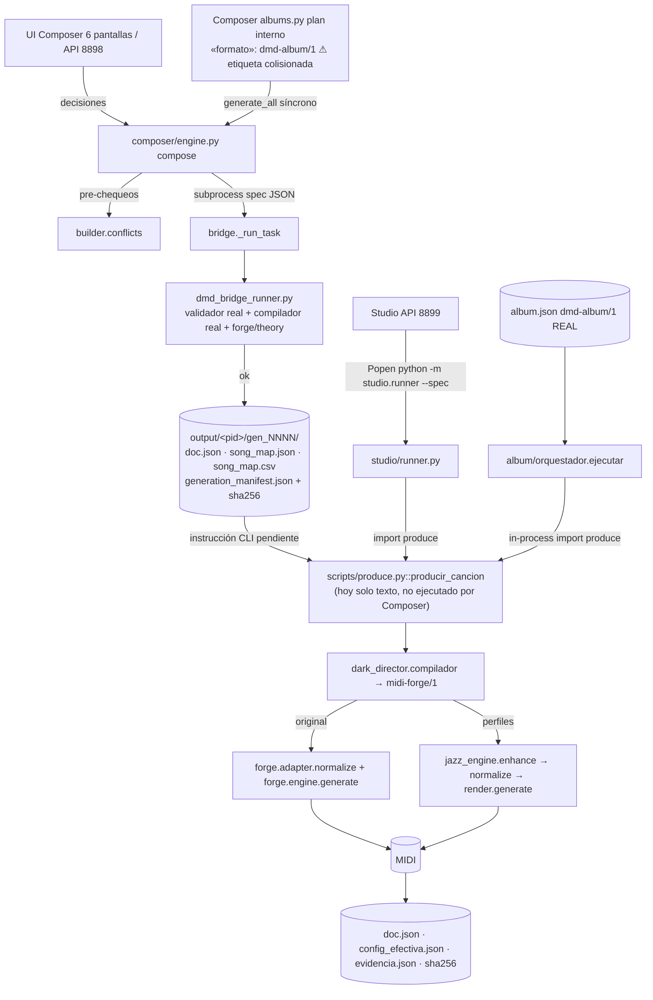
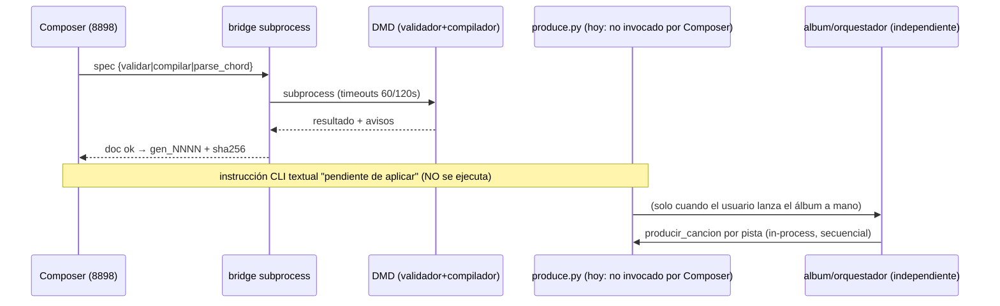

# AUDIT_CURRENT_ARCHITECTURE — Reconstrucción de la arquitectura actual

> Misión: DMD Composer como centro de producción musical · Fecha: 2026-11-11 · Evidencia: VERIFIED salvo marca contraria.
> Todo lo citado con `Archivo:Línea` fue leído íntegramente durante la auditoría.

---

## 1. Componentes del sistema

| Componente | Ubicación | Puerto | Rol real (verificado) | Dependencias |
|---|---|---|---|---|
| **DMD Composer 1.1** | `/home/z/my-project/DMD_Composer` (hermano del proyecto de motores) | **8898** (`composer/__main__.py:10-23`) | Dirección musical: proyectos `dmd-composer/1`, 16 ejes fixed/auto/free, armonía nativa/guiada, acordes literales, protagonista con propuesta, Song Map, modo álbum compositivo, doc `dark-director/1` validado+compilado con los motores reales | fastapi, uvicorn (capa web); motores DMD vía **subprocess** |
| **DMD Studio** | `nucleo_engine_project/studio/` | **8899** (`studio/__main__.py:31`) | Cliente operativo de producción: proyectos, composición, generación vía `python -m studio.runner --spec` | fastapi, uvicorn (`requirements-studio.txt`: fastapi==0.115.6, uvicorn==0.34.0) |
| **dark_director/** | `nucleo_engine_project/dark_director/` | — | Contrato rev 3.2 (`contract.py`, PROTEGIDO), validador E1xx/E2xx/E3xx/W4xx, compilador → `midi-forge/1`, recetas N1, identidades (activa `dark_triphop`, archivadas doom) | stdlib |
| **forge/ (MIDI Forge)** | `nucleo_engine_project/forge/` | — | ÚNICO motor MIDI (`engine.generate`), teoría (`theory.py` — parser de acordes), adaptador (normaliza canales), audio (`audio.py` — WAV FluidSynth + MP3 ffmpeg/lame + master FX) | stdlib; FluidSynth/ffmpeg/lame (binarios externos) |
| **jazz_engine/** | `nucleo_engine_project/jazz_engine/` | — | Capa mejorada (sax frases, Rhodes, drums, vibes), perfiles de producción (7), biblioteca F7 opcional, CLI `python -m jazz_engine` | stdlib + forge vía `forge_link` |
| **album/** | `nucleo_engine_project/album/` | — | Orquestador de álbumes: esquema `dmd-album/1`, planificador determinista, diversidad PRE/POST, resume, informe | dark_director + jazz_engine + produce (in-process) |
| **scripts/produce.py** | `nucleo_engine_project/scripts/` | — | Núcleo de producción de UNA pista (`producir_cancion`) + CLI | dark_director + jazz_engine + forge |
| **app.py + web/** | raíz del proyecto | (legado 8765-8774) | Convertidor antiguo; **excluido explícitamente** por decisión DS-10 | — |
| **Almacenes de datos** | `composer_data/` (proyectos Composer), `DMD_Composer/output/` (generaciones), `studio_data/` (proyectos/generaciones/jobs/ajustes de Studio), `output/` (historial CLI/álbumes), `albumes/` (specs) | — | Persistencia por ficheros JSON, escritura atómica en Composer y Studio (no en `album/`) | — |
| **`nucleo_engine_project_light/`** | hermana (564 ficheros) | — | Copia de distribución ligera del proyecto (con album/ y specs; sin outputs pesados) — propósito UNVERIFIED más allá del contenido | — |

## 2. Flujo de datos y de ejecución (reconstrucción verificada)

**Tres rutas de producción equivalentes** (VERIFIED byte-idénticas): CLI `produce.py` = CLI `python -m jazz_engine` = runner headless de Studio (mismo doc+perfil+seed → mismo SHA256).

## 3. Entradas, salidas y contratos

| Contrato | Esquema | Árbitro | Estado |
|---|---|---|---|
| Documento musical | `dark-director/1` **rev 3.2** (40 códigos E/W; `contract.py:14-19,146-201`) | `dark_director.validador.validar` + `compilador.compilar` — los ÚNICOS árbitros; Composer/Studio solo anticipan | Congelado, intacto (hashes verificados) |
| Proyecto intermedio | `midi-forge/1` | `forge.validate` | Congelado |
| Side-config de motores | JSON con `production/engines/seed/density/variation/harmony` (NO es contrato) | `jazz_engine.production` / `coordinator.normalize_config` | Estable (F6/F7) |
| Álbum | `dmd-album/1` real (`album/esquema.py:43-51`): `schema, album, semilla_album, pistas[{id, doc, perfil?, seed?, harmony?}], objetivo?, curva_energia?, restricciones?` | `ES.cargar_album` fail-fast A1xx acumulados | Estable (F8) |
| Proyecto Composer | `dmd-composer/1` (interno) | validación propia de `server.py` | Estable (v1.1) |
| ⚠ Plan de álbum de Composer | `composer/albums.py:58` escribe `"formato": "dmd-album/1"` con **estructura distinta** (`compartido`, `pistas[{n,estado,seed,key,bpm,...}]`) | ninguno | **Colisión de nombre** — no confundir con el esquema real |

## 4. Integraciones existentes (lo que ya está conectado)

| De → A | Mecanismo | Evidencia |
|---|---|---|
| Composer → validador/compilador reales | subprocess con spec JSON, timeouts 60/120 s, fingerprint de compatibilidad (`manifest.py:56-103`) | `bridge.py:57-85`, `dmd_bridge_runner.py:30-46` |
| Studio → produce | `Popen([sys.executable,"-m","studio.runner","--spec",spec], cwd=ROOT)`; single-flight 409; timeout 900 s; `recover_interrupted()` | `studio/jobs.py:220-321`, `runner.py:30-71` |
| album → produce | `import produce` in-process + `producir_cancion(..., indice=False)` | `album/orquestador.py:125-128,183-186` |
| Composer → `forge/theory.parse_chord` | subprocess (prevalidación de acordes literales) | `server.py:405-423`, `dmd_bridge_runner.py:168-198` |
| Composer/Studio → catálogos | introspección viva del DMD + caché + instantánea builtin con fingerprint | `composer/manifest.py:72-103`, `studio/capabilities.py` |

## 5. Lo que NO está conectado todavía (brechas de integración)

1. **Composer → producción MIDI**: no existe ningún endpoint ni tarea de bridge que ejecute `producir_cancion`; solo la instrucción textual (`engine.py:75-115`).
2. **Composer → orquestador DMD**: 0 referencias a `album/` en `composer/` (grep VERIFIED); el plan de Composer no es exportable como spec real.
3. **Cualquiera → WAV/MP3 con éxito**: el código existe (`forge/audio.py`) pero el hijo de Studio se arranca con env sin `PATH` (`jobs.py:265-270`) → 8/8 jobs `wav=true` fallidos con `RuntimeError: FluidSynth no encontrado` (registros en `studio_data/jobs/`).
4. **Capa de asignación de soundfonts / sfizz**: no existe (un solo SF2 por render).

## 6. Acoplamiento interno (lo que conviene no ampliar)

| Punto de acoplamiento | Detalle | Consecuencia |
|---|---|---|
| `composer/server.py` (655 líneas) | módulo-dios: config + validación de todos los ejes + proyectos + protagonista + armonía + álbumes + estáticos; hasta 4 resoluciones de manifiesto por PUT | Añadir producción aquí sin extraer módulos lo hará insostenible |
| `composer/engine.compose()` | 8 responsabilidades en una función | El hook de producción debe ser una capa aparte, no un 9º bloque |
| `composer/builder.conflicts()` | monolito ~300 líneas que espeja al validador | Riesgo de desalineación con el validador real (ya ocurrió una vez, M2) |
| `composer/albums.py ↔ store` | `ALBUMS_DIR = store.OUTPUT_DIR/"albumes"` convive con `delete_project` que borra `OUTPUT_DIR/<pid>` | Un pid `"albumes"` al borrarse eliminaría los planes de álbum (riesgo, no ejecutado) |
| SANO | El acoplamiento con DMD está bien aislado: solo `dmd_bridge_runner.py` importa motores, en hijo, con fingerprint | **Replicar este patrón** para producción |

## 7. Diagrama de la cadena completa hoy (estado real)

## 8. Conclusión arquitectónica

La arquitectura actual está **correctamente estratificada** (dirección → contrato → motor único → orquestación) y su mecanismo de integración (subprocess con spec JSON + fingerprint) está probado en dos aplicaciones independientes (Composer y Studio) sin duplicar motores. La brecha hacia «centro de producción» es **aditiva, no correctiva**: un puente más (produce/álbum), una capa de estados, y las capas de audio sobre `forge/audio.py` — sin tocar el contrato, los motores protegidos ni Studio.
