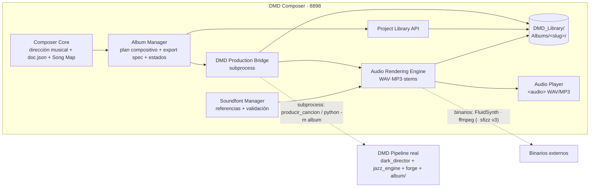

# AUDIT_TARGET_ARCHITECTURE — Arquitectura final recomendada

> Misión: DMD Composer como centro de producción musical · Fecha: 2026-11-11 · Diseño objetivo derivado de la evidencia; respeta las 17 restricciones permanentes de la misión (Python/FastAPI/uvicorn, vanilla JS, local-first, subprocess aislado, sin duplicar motores, contrato rev 3.2 intacto…).

---

## 1. Diagrama de módulos objetivo

## 2. Responsabilidades e interfaces por módulo

### A. Composer Core (existente — reutilizar sin cambios funcionales)
- Mantener: proyectos `dmd-composer/1`, ejes fixed/auto/free, armonía nativa/guiada, protagonista, Song Map, validación/compilación reales vía bridge, manifest con fingerprint.
- Interfaces que ya existen y se conservan: `engine.compose()`, `store.save_generation`, `bridge._run_task`, `manifest` fingerprint.

### B. Album Manager (nuevo módulo en `composer/` — a partir de `albums.py`)
- Responsabilidades: plan compositivo 2–64 pistas (ya existe), **export del spec `dmd-album/1` REAL** (nuevo), estados por pista de producción (traducción de `estado.json` del orquestador), disparo/cancelación de la producción de un álbum, progreso.
- Interfaces nuevas: `export_album_spec(album_id, out_dir) -> album.json` (calcula hash canónico, espejo `docs/`, perfiles/seeds/harmony desde la instrucción de producción); `read_album_state(slug) -> estados por pista`.
- No duplica: ni planificación de producción ni diversidad POST (las hace el orquestador).

### C. DMD Production Bridge (nuevo módulo `composer/production.py` + runner hijo)
- Patrón idéntico al existente: tarea `"produce"` en `dmd_bridge_runner.py` + spec JSON + timeouts + argv fijo + sin shell.
- Pista única: subproceso que importa `producir_cancion(doc, production, seed, harmony, out_dir, verify, indice=False)` y devuelve el dict estructurado (contrato en `AUDIT_PRODUCTION_PIPELINE.md §8`).
- Álbum completo: subproceso `python -m album producir <album.json> --out <Library>` (proceso por álbum, watchdog del llamador).
- Errores mapeados a HTTP: 422 (DirectorInvalido/E-codes), 400 (perfil/config), 404, 409 (single-flight), 504 (timeout), 499 (cancelación).
- Garantías: `out_dir` único por intento, `PYTHONDONTWRITEBYTECODE=1`, `indice=False`, sha256 en cada resultado.

### D. Audio Rendering Engine (nuevo `composer/audio_render.py`; usa `forge/audio.py` como librería vía subproceso del runner)
- v1: WAV (FluidSynth, comando VERIFIED) + MP3 (ffmpeg libmp3lame + ID3) por pista; validación de duración del WAV (gap a añadir en la capa, no en forge).
- v2: stems por canal + mezcla ffmpeg (`amix normalize=0` + `alimiter` + `apad` + loudnorm 2 pasadas).
- v3: sfizz para SFZ (tras verificación Windows; fallback GM).
- Consume el perfil `render_profile.json` del álbum/pista (AUDIT_HYBRID §2). **Nunca modifica el MIDI fuente.**

### E. Audio Player (nueva vista/página en la UI vanilla)
- `<audio>` HTML5 sobre WAV/MP3 servidos por endpoint whitelisted (mismo patrón que `get_gen_file`); play/pause/stop/posición/volumen nativos del elemento; sin sintetizador JS ni dependencias nuevas.
- MIDI «reproducible» = render WAV on-demand (no hay player MIDI nativo de navegador sin dependencias).

### F. Soundfont Manager (nuevo `composer/soundfonts.py`)
- Descubrir (rutas conocidas de `forge/audio.py` + escaneo de `DMD_Library/soundfonts.json`), registrar (name/path/sha256/size/format), validar (existencia, legibilidad, sha), asignar (editor del `render_profile.json`), detectar rotas (error explícito con campo culpable), re-vinculación manual tras mover un banco.

### G. Project Library (nuevo `composer/library.py` + estructura `DMD_Library/` — AUDIT_PROJECT_LIBRARY)
- Álbumes/pistas/artefactos/historial/estados/hashes; reproducción y descarga de cualquier trabajo anterior; recuperación tras fallos; referencias a soundfonts; limpieza de temporales.
- Ubicación configurable (default: `<raíz usuario>/DMD_Library`) — decisión del usuario (OPEN_QUESTIONS #5).

## 3. Contratos entre componentes (resumen; detalle en los documentos hermanos)

| Contrato | Entre | Formato |
|---|---|---|
| Spec de álbum | Album Manager → orquestador DMD | `dmd-album/1` real (esquema A1xx) + espejo `docs/` |
| Resultado de producción | Bridge → Album Manager/UI | dict `{ok, sha256, out_dir, midi, evidencia, bpm, duracion_s, compliance, huella}` + `estado.json` |
| Estado por pista | Orquestador → Composer | `estado.json` (`ok|fallo|pendiente` + `especificacion`) |
| Perfil de render | Soundfont Manager → Rendering Engine | `dmd-render-profile/1` |
| Referencias de soundfonts | Soundfont Manager → Library | `soundfonts.json` (name/path/sha256/size) |
| Artefactos | cualquiera → Library | ficheros inmutables + `evidencia.json` + `manifiesto.json` con `--verify` |

## 4. Flujo de datos objetivo (13 pistas)

1. Usuario define álbum en Composer (identidad, diversidad, perfiles, duraciones) → plan compositivo.
2. `generate_all` (a convertir en job asíncrono con progreso) compone N docs + Song Maps, validados/compilados reales.
3. Usuario pulsa «Producir álbum» → Album Manager **exporta** `album.json` real + espejo docs → Bridge lanza `python -m album producir` → la Library recibe MIDIs + estados en vivo (poll de `estado.json`).
4. Por pista: `MIDI_READY` → (si audio habilitado) Soundfont Manager valida perfil → Rendering Engine produce WAV→MP3 → `AUDIO_READY` → Player reproduce.
5. Fallo de pista: `fallo` con traceback; el álbum continúa; reintento selectivo (`--regen id` o botón «Reintentar» que lo invoca).
6. Todo queda en `DMD_Library/Albums/<slug>/` con hashes y manifiesto reproducible.

## 5. Límites de responsabilidad (qué NO hace cada capa)

| Capa | Jamás debe |
|---|---|
| Composer Core | Generar notas, tocar `development.*`, inventar campos de contrato, imponer F7 |
| Album Manager | Planificar producción (lo hace el orquestador) ni duplicar diversidad POST |
| Production Bridge | Importar motores en el proceso del servidor; escribir fuera de `out_dir`/Library |
| Rendering Engine | Modificar el MIDI fuente; renderizar con referencias rotas sin error |
| Player | Sintetizar audio en el navegador |
| Library | Decidir música o reescribir artefactos aceptados |

## 6. Desviaciones justificadas respecto a ideas habituales

1. **Sin cola de jobs con worker persistente**: single-flight + proceso por álbum cubren el caso local (VERIFIED: 0,17 s/pista MIDI; WAV es el único trabajo largo y es secuencializable).
2. **Sin SQLite**: ficheros+JSON+sha256 (patrón DS-6 probado; volumen pequeño).
3. **Sin reescritura de la UI**: nuevas vistas HTML estáticas servidas por el mismo FastAPI (patrón actual, vanilla JS).
4. **El orquestador DMD no se modifica salvo robustez** (atomicidad/watchdog — Fase 0 con autorización del usuario, pues toca código FASE 8 no protegido).
5. **Player via WAV/MP3**: el reproductor MIDI nativo en navegador exigiría dependencias nuevas (prohibido sin necesidad).
